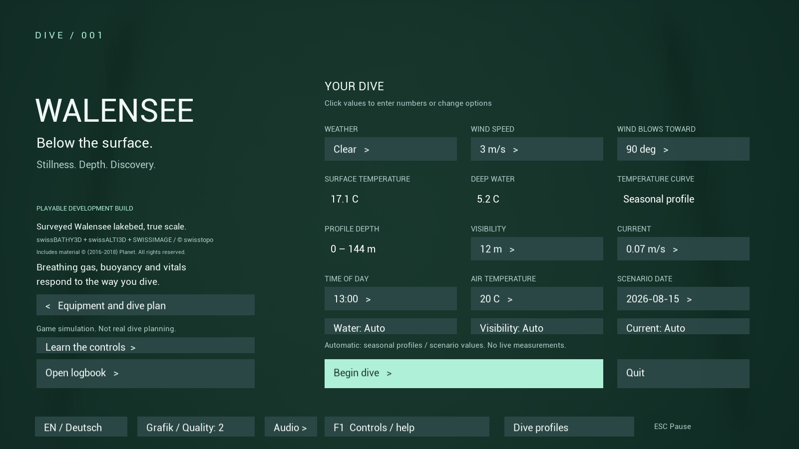

# Automatische Umweltkonfiguration

Unter **Wetter und Wasser** lassen sich Wassertemperatur und Sichtweite jeweils zwischen Automatik und eigenen Werten umschalten. Die Strömung bietet **Auto, Keine, Leicht, Stark, Manuell**. Die Auswahl wird mit den Einstellungen und benannten Tauchprofilen gespeichert. Ältere Profile bleiben vollständig manuell.

Die Oberfläche zeigt bereits die für Datum und Wetter berechneten Werte. Beim Tauchstart wird daraus eine feste Konfiguration. Änderungen während des Tauchgangs sind gesperrt. Die gespeicherten manuellen Werte bleiben erhalten; eine gültige Zahleneingabe bei Sicht oder Strömung schaltet dieses Feld auf manuell, Abbrechen und ungültige Eingaben ändern nichts. Bei automatischer Wassertemperatur sind die Temperaturfelder schreibgeschützt, weil ein vollständiges Tiefenprofil verwendet wird. Die Lufttemperatur bleibt ein eigener manueller Wert.

## Wassertemperatur: Quelle und Modell

Die numerischen saisonalen Walensee-Profile stammen aus dem von Eawag ThermDis bereitgestellten [Lakes.json](https://www.thermdis.eawag.ch/static/templates/json/Lakes.json), abgerufen am 25. November 2026. ThermDis bietet die Datei auf seiner [Datenseite](https://www.thermdis.eawag.ch/en/potential/) zum Download an; das [Impressum](https://www.thermdis.eawag.ch/en/impressum/) nennt die kantonalen Stellen als Herkunft der Temperaturbeobachtungen. Die Beobachtungsjahre werden in dieser JSON-Datei nicht angegeben. Dies sind **keine aktuellen Messungen oder Vorhersagen**.

Im Repository liegen ausschließlich die extrahierten numerischen Walensee-Temperaturwerte und ihre Herkunft: [WALENSEE_TEMPERATURE.json](WALENSEE_TEMPERATURE.json). Der SHA-256 bezieht sich auf die heruntergeladene vollständige Quelldatei; diese wird nicht mitverteilt. Die Zahlenextraktion behauptet keine zusätzliche Lizenz für die gesamte ThermDis-Datenbank oder deren Begleittexte.

Vier Profile mit je 17 Stützstellen decken 0 bis 144 m ab. Zwischen Tiefen wird linear interpoliert; unterhalb 144 m bleibt der letzte Temperaturwert konstant. Für den Jahresverlauf sind die Mittelprofile den **modellierten Stichtagen 15. Februar, 15. Mai, 15. August und 15. November** zugeordnet. Zwischen diesen Stichtagen wird nach tatsächlichen Kalendertagen interpoliert, einschließlich Schaltjahr und Jahreswechsel. Diese Stichtage sind unsere Interpolationsentscheidung, keine Messdaten der Quelle. Der gewählte Szenariotag bleibt während eines Tauchgangs fest. Wetterwechsel verändern das Temperaturprofil nicht unmittelbar. Das gleiche Tiefenprofil gilt im ganzen See; räumliche Temperaturunterschiede werden nicht modelliert.

Beispiele direkt an den saisonalen Stichtagen: Oberfläche im Winter 5,836 °C, im Sommer 17,085 °C; bei 30 m im Frühling 6,121 °C. Das tatsächliche Profil ersetzt bei eingeschalteter Automatik die manuelle sigmoidale Sprungschicht. Vorschau, simulierte Körperkühlung, Instrumente und gespeicherte Messpunkte verwenden dieselbe Kurve.

## Sicht und Strömung: gestaltete Szenariowerte

Diese Werte sind **keine örtlichen Beobachtungen**. Die folgenden Regeln geben reproduzierbare Spielbedingungen:

| Saison | Basissicht | Grundströmung |
|---|---:|---:|
| Winter | 18 m | 0,04 m/s |
| Frühling | 10 m | 0,09 m/s |
| Sommer | 12 m | 0,06 m/s |
| Herbst | 15 m | 0,05 m/s |

Die saisonalen Basiswerte verwenden dieselben Stichtage. Sicht = Basissicht × Wetterfaktor ÷ `(1 + 0,025 × max(0, Wind − 3))`, begrenzt auf 2–40 m. Wetterfaktoren für heiter/bedeckt/Regen/Sturm: 1 / 0,95 / 0,6 / 0,35. Automatische Strömung = Grundströmung + `0,004 × Wind` + Regenzuschlag (0 / 0 / 0,02 / 0,04 m/s). Wind wird in m/s eingesetzt. Die Presets sind keine = 0, leicht = 0,08, stark = 0,30 m/s; eigene Werte reichen von 0 bis 0,5 m/s.

Die wirksame Sichtweite steuert Unterwassermaterial, Nebel, Wasseroberfläche und Lampendämpfung. Die Strömung wirkt auf Schwimmen/Waten, Umgebung und Blasen. Das bestehende Strömungsmodell bleibt räumlich einheitlich entlang der lokalen Y-Achse, ergänzt um Wellenbewegung. Es bildet keine lokale Hydrodynamik oder windabhängige Strömungsrichtung ab.

Tauchprotokolle enthalten die wirksamen Werte, Auswahlkennzeichen, Modellkennungen und bei automatischer Temperatur alle 17 für den Tauchtag aufgelösten Stützstellen. Die weiterhin exportierten manuellen Sprungschichtparameter sind bei `temperature_model=thermdis_walensee_v1` inaktiv. Profil-/Einstellungsdateien enthalten dagegen die gespeicherten manuellen Werte und die Automatik-Auswahl, damit Umschalten verlustfrei bleibt.

## Reproduktion

```powershell
./Tools/TestCore.cmd
./Tools/Build.ps1 -Target Editor -EditorSandbox
./Tools/TestProfiles.ps1 -EditorSandbox
./Tools/SmokeTest.ps1 -EditorSandbox -Scenario environment
./Tools/Build.ps1 -Target Package -EditorSandbox -BuildSlot Environment -PackageDirectory Builds/WindowsEnvironment
./Tools/TestEnvironment.ps1 -PackageDirectory Builds/WindowsEnvironment
Tools/.geodata-env/Scripts/python.exe Tools/ReportEnvironment.py artifacts/environment-validation-YYYYMMDD-HHmmss
```

Die Datenextraktion erfolgt bei Bedarf mit `python Tools/import_temperature_profile.py <lokale-Lakes.json>`. Spiel und Build benötigen dafür keinen Netzwerkzugriff.

Die Paketmatrix prüft Winter-/Sommertauchgänge, manuelle Werte, Zahlenfelder, Profile, Uferzugang und Lampe. Der separate Bericht vergleicht die exportierten Temperaturen aller Messpunkte mit den extrahierten Eawag-Stützstellen, kontrolliert Modellkennungen und wirksame Sicht-/Strömungswerte. Native Prüfungen kontrollieren zusätzlich die tatsächlich gesetzten Materialparameter und die Sperre während eines Tauchgangs. Jeder Fall erhält einen eigenen Laufzeitlog; `-ResumeDirectory` akzeptiert nur denselben EXE-Hash und unveränderte Testoptionen.

Der Bildtest vergleicht die erste Menüaufnahme mit einer späteren Aufnahme und verlangt sichtbare Textpixel für Wind, Richtung, Strömung, Uhrzeit und Datum. Geprüft werden die tatsächlichen PNG-Daten sowie die Menüansichten in Deutsch und Englisch.

Bezug zu CONF-005/006/007 und ENV-009. Die saisonale Konfiguration ersetzt weder die vollständige visuelle Abnahme noch die fachliche Validierung des gesamten Tauchmodells.

## Geprüfter Windows-Stand

Paket: `Builds/WindowsEnvironment/divingsim.exe`. Tatsächlich gestartete Spieldatei: `divingsim/Binaries/Win64/divingsim-Environment.exe`, SHA-256 `4212AC8674D9DDD82AAC94D864D5C4366A10AD1D93BCC18D0E90420E81F0A122`. Quellstand: `faa84b514419e751061eb18b3e2e87bfe9a3ff73`. Alle 85 Source-/Config-Dateien stimmen mit der isolierten Build-Kopie überein. Der vorherige Partikel-Build bleibt unverändert.

| Prüfung | Ergebnis |
|---|---|
| Portabler C++-Kern und Python | 0 Fehler im Kern, 15 Python-Tests bestanden; CI auf Windows/macOS/Ubuntu erfolgreich |
| Native Unreal-Profile | 3 Tests bestanden, einschließlich aller 20 Kombinationen aus Temperatur-/Sichtautomatik und Strömungsquelle |
| Eigenständiges Paket | 8 Szenarien bestanden, 42 frische 1600 × 900-PNGs |
| Temperaturprotokolle | Maximaler Fehler gegenüber unabhängiger Interpolation der Quelldaten unter 0,00000001 °C |
| Materialübergabe im Regenszenario | Tatsächliche Unterwassersicht 640 cm, Lampenextinktion 0,002265625/cm; Weltströmung und Oberflächenabsorption geprüft |
| Erste Menüaufnahme | Textmasken für Wind, Richtung, Strömung, Uhrzeit und Datum vollständig und pixelgleich mit späterer Aufnahme |
| Normaler Root-Starter | Startet die richtige Environment-EXE, beendet den automatischen Tauchgang mit 23 Messpunkten und Exitcode 0 |
| 1080p, Qualität 2, 100 % Auflösung | 15 s Aufwärmen + 60 s Messung, 5.389 Bilder; 89,84 FPS im Mittel, 72,80 FPS im langsamsten Prozent; maximal 15,117 ms, kein Bild über 16,67 ms |

Messrechner: RTX 3090 / Ryzen 9 9950X3D, UE 5.8.4. Beim Leistungsstart liefen keine weiteren Unreal-/Spielprozesse; sonstige Desktoplast wurde nicht vollständig ausgeschlossen. Die Messung verwendet das bestehende Unterwasser-Referenzszenario mit manuellen Standardwerten. Sie ist keine allgemeine Hardwarefreigabe. Ein nativer macOS-Spielbuild ist weiterhin ungeprüft.

Maschinelle Ergebnisse mit Prüfsummen: [ENVIRONMENT_RESULTS.json](ENVIRONMENT_RESULTS.json), [ENVIRONMENT_PERFORMANCE.json](ENVIRONMENT_PERFORMANCE.json). Rohdaten: `artifacts/environment-validation-20261125-164803`, `artifacts/perf-underwater-1080p-q2-20261125-165158-957`, `artifacts/environment-bootstrap.log`.

## Echte Paketaufnahmen

Automatik am modellierten Winterstichtag, deutscher Dialog:


Automatik am modellierten Sommerstichtag, englischer Dialog. Die Werte sind offline berechnete Szenariobedingungen:


