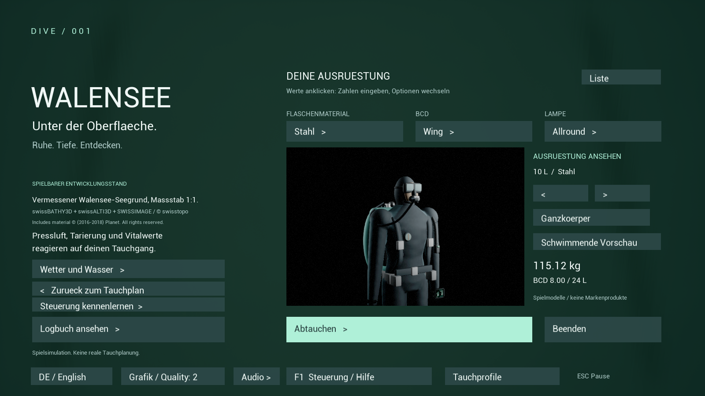
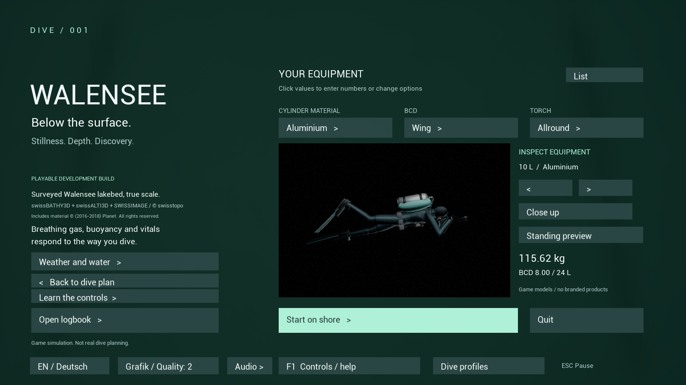

# Articulated diver and equipment inspection

The diver now has a world-space articulated body. The camera supplies eye position and hand targets; it does not carry a pair of disconnected sleeves. A weighted dry suit or thinner wet suit follows shoulders, elbows, hips and knees. A two-bone arm solver preserves segment lengths and clamps unreachable hand targets. Walking and swimming use separate leg amplitudes, with alternating kicks, extended swimming ankles and flexible fin blades. Animation freezes during an active dive's pause.

The equipment page offers **3D ansehen / 3D view**, rotation, a close view and an animated swimming preview before starting. The preview uses the selected loadout, including the cylinder, BCD, suit, ballast pockets and hand torch. During a paused dive it displays the frozen live pose. Changing the preview cannot alter the active dive's loadout or advance its simulation. The render capture updates at most ten times per second while open; its two studio lights use an isolated lighting channel and switch off when closed.





## Models and rendering

Nineteen original assets are generated by `Tools/create_avatar_assets.py`:

- Two weighted suit bodies with a thirteen-bone imported hierarchy.
- Six cylinder meshes: steel and aluminium, each in 10, 12 and 15 litre forms. Other configured capacities scale the closest mesh by the cube root of the catalogue's displacement ratio.
- Jacket, Travel and Wing BCDs, including their webbing, pockets and inflator.
- Hood, mask, second stage, boots, fin, ballast pockets, regulator hose and chest compass.

The existing gloves, wrist computer and three torches remain attached to the solved hands. The displayed computer still uses live simulation values. The second stage moves between mouth and chest, and a procedural hose follows its changing endpoint. The chest compass rotates with heading. Head geometry is hidden from the player's own view while remaining visible in inspection and shadows.

Meshes have vertex colours and three generated distance LODs. Materials distinguish suit weave, rubber and cylinder metal; the fin material bends its free blade while retaining its foot pocket. These are authored game models, not reproductions of certified commercial equipment.

## Reproduction

Run Blender as a separate background process, leaving open user scenes untouched:

```powershell
& 'C:/Program Files/Blender Foundation/Blender 5.3/blender.exe' --background --factory-startup --python-exit-code 1 --python Tools/create_avatar_assets.py
./Tools/Build.ps1 -Target Editor -EditorSandbox
./Tools/Build.ps1 -Target Content -OnlyAvatar -EditorSandbox
./Tools/TestAvatar.ps1 -EditorSandbox
./Tools/TestAvatar.ps1 -PackageDirectory Builds/WindowsAvatar
python Tools/ReportAvatar.py artifacts/avatar-validation-YYYYMMDD-HHMMSS --output artifacts/avatar-report.json
```

The source scene is `blender/AvatarAssets.blend`; FBX files and geometry counts are in `blender/exports/Avatar/`. The dedicated Unreal import uses the FBX factory, explicitly replaces import settings and restores the prior Interchange setting afterwards. Skeletal material structures must be written back into the Unreal array after editing; otherwise their copied values do not persist. Material graph connections and asset saves are checked. The runtime fixture additionally rejects missing suit material, absent vertex colour buffers, incorrect model selections, invalid import units and changing limb lengths.

## Limits

This is an articulated procedural model with analytic movement, not scanned anatomy or motion capture. The player still collides through the existing movement capsule/support model; hands, fins, cylinder and torso do not have independent physical collisions. There is no cloth simulation, dynamic strap tension, finger articulation or geometrically expanding BCD bladder. Head orientation follows the torso; independent neck/gaze motion is not implemented. Contact-aware foot placement, all-body contact behaviour, detailed anatomical/material review and photorealistic acceptance remain open. The new geometry addresses DIVR-011/012 and EQPM-012 in part; it does not complete their wider contextual acceptance or the full 236 requirements.

## Verification

`Tools/TestAvatar.ps1` exercises six combinations across all three BCDs, both cylinder materials, all three cylinder sizes and both suits. Each case checks front/back/detail and swimming views, live first-person use, the raised computer, pose freezing and resumption. The sixth case starts on shore. Fresh screenshots are required for every view; numerical checks do not replace their visual review.

The packaged six-case matrix passed on 25 November 2026, with 48 fresh screenshots. This covers each variant at least once, not every possible combination. Evidence: [native matrix](AVATAR_RESULTS.json), [build, source/asset hashes and unit checks](AVATAR_BUILD.json). The Windows executable SHA-256 is `53396e975540fd233eee10ec79328e9bc7da315963525a7fd953253f58edf929`. All 94 source/configuration files match the packaged sandbox snapshot; the 25 avatar assets are hashed separately. Eleven Unreal automation tests, fifteen Python tests and the portable simulation checks passed. The previous WindowsLoadout executable retains its recorded SHA-256.

Thirteen additional packaged regressions passed: all three shore routes, daytime/night wrist-computer pages, all three torches, breathing-source switching, tutorial, a heavy loadout, Exploration and Hardcore. They produced 68 fresh screenshots, giving 19 scenarios and 116 screens across the two matrices. The equipment front/back/close/swimming views, first-person watch, shore look-down and spot-torch beam were visually spot-checked. Evidence: [gameplay regressions](AVATAR_REGRESSION.json). Native macOS, performance on minimum hardware, a long-session run of this build and the full visual/requirements acceptance remain open.

A 60-second underwater capture after 15 seconds of warmup at 1920×1080, quality 2 and 100% render scale measured **88.81 mean FPS / 72.17 one-percent-low FPS** on the RTX 3090 / Ryzen 9 9950X3D. All 5,326 measured frames stayed below 16.67 ms; the maximum was 14.8403 ms. No other Unreal editor or game instance was present at capture start. [Performance evidence](AVATAR_PERFORMANCE.json) includes the exact settings, host context and artifact hashes. This one scene and machine do not establish general performance. The ordinary root EXE also launched the expected named game executable and completed its gameplay check with exit code 0: [launcher evidence](AVATAR_LAUNCHER.json).
