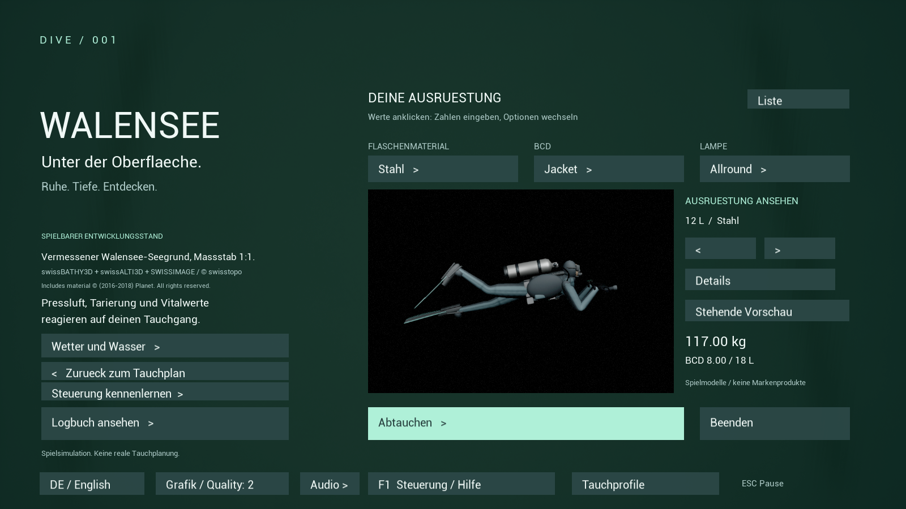

# Gaze, swimming posture and breathing landmarks

This report records the WindowsBody increment. The subsequent [body-contact implementation](CONTACTS.md) adds a shared physical pose and compound collisions; cosmetic camera bob is now separate from the physical eye anchor.

The head, mask and second stage now follow the player's gaze around a neck joint. Previously they pitched rigidly with the torso, so a horizontal swimmer appeared to look down while the player looked forward. The shared `FDiveBodyFrame` keeps the authored eye landmark at the camera and computes the torso placement around it. Extreme gaze angles bring the shoulders along within an animation range of −60° to +90° at the neck. These limits are authored game constraints, not anatomical validation.

A submerged swimmer retains horizontal trim while stationary or reading the wrist computer. Walking uses the standing base pose; near the surface the swimmer can return upright. The second stage rotates with the head when inserted and interpolates back to its chest position when removed; its flexible hose follows the transformed connector. Cylinder placement now aligns the valve below the neck for each selected cylinder length, instead of using a fixed centre that let the extended head intersect the valve. Inspection lighting follows the viewing angle so the visible side remains lit when rotating or pitching the body.



The physical mouth position uses the same eye-to-mouth landmark and the control rotation. It is evaluated inside the simulation step, independently of rendering and cosmetic camera bob. The local wave height is sampled at the mouth. Looking up near the waterline can therefore lift the mouth into air while the eyes stay in place. Exhaled bubble placement uses this landmark too. Body immersion still uses the earlier simplified shore model; this change does not provide full anatomical water displacement.

Unreal's quaternion-to-Euler conversion can snap near a 90° local pitch. With the model's off-origin head mesh, that produced a measurable eye-position error. The component update now preserves the explicit local pitch and refreshes its world transform. A native scene-component regression exercises the near-vertical angles in addition to the mathematical landmark checks.

## Reproduce

```powershell
./Tools/Build.ps1 -Target Editor -EditorSandbox
./Tools/Build.ps1 -Target Package -EditorSandbox -BuildSlot Body -PackageDirectory Builds/WindowsBody
./Tools/TestAvatar.ps1 -PackageDirectory Builds/WindowsBody
./Tools/SmokeTest.ps1 -Packaged -PackageDirectory Builds/WindowsBody -Scenario breathing
./Tools/SmokeTest.ps1 -Packaged -PackageDirectory Builds/WindowsBody -Scenario wrist
./Tools/SmokeTest.ps1 -Packaged -PackageDirectory Builds/WindowsBody -Scenario wrist-night
./Tools/SmokeTest.ps1 -Packaged -PackageDirectory Builds/WindowsBody -Scenario shore -Entry 0
./Tools/SmokeTest.ps1 -Packaged -PackageDirectory Builds/WindowsBody -Scenario shore -Entry 1
./Tools/SmokeTest.ps1 -Packaged -PackageDirectory Builds/WindowsBody -Scenario shore -Entry 2
./Tools/SmokeTest.ps1 -Packaged -PackageDirectory Builds/WindowsBody -Scenario tutorial
```

The avatar fixture now has 25 phases and eleven required screenshots per equipment case. It adds extreme upward gaze and inserted/removed-regulator inspection to the previous matrix, and checks that reading the computer does not stand a submerged swimmer upright. Runtime validation checks eye and mask alignment, gaze and the inserted second stage. The native body tests also cover rotated world frames, pitch wrapping, invariant neck position, regulator endpoints and the mouth crossing a flat waterline.

## Verification

The packaged WindowsBody matrix passed all six equipment cases and all 25 phases per case, with 66 fresh screenshots: [avatar evidence](BODY_POSE_RESULTS.json). Seven further packaged regressions passed—three shore routes, daytime/night wrist-computer use, breathing-source switching and the tutorial—with 48 fresh screenshots: [gameplay evidence](BODY_POSE_REGRESSION.json). Together these cover 13 scenarios and 114 screenshots. The swimming preview, equipment detail, extreme gaze, regulator inspection and first-person computer views were visually spot-checked; screenshots are not automatic visual acceptance.

Fifteen Unreal automation tests, fifteen Python tests and the portable simulation checks passed. The 96 source/configuration files match the build sandbox, and all 25 avatar assets retain their preceding hashes. The new executable SHA-256 is `b266ec7ffa39dcff517fec78ad344a1b317990c645acac15b0aefd025cd08c33`; the WindowsAvatar executable retains its previous SHA-256. [Build and source evidence](BODY_POSE_BUILD.json) records the hashes and local logs.

A 60-second underwater capture after 15 seconds of warmup measured **88.31 mean FPS / 72.25 one-percent-low FPS**, at 1920×1080, quality 2 and 100% render scale on the RTX 3090 / Ryzen 9 9950X3D. All 5,297 measured frames stayed below 16.67 ms; the maximum was 14.3582 ms. No other Unreal editor or game instance was present at capture start. [Performance evidence](BODY_POSE_PERFORMANCE.json) records the settings, host and artifact hashes. This single scene and host do not establish performance on minimum hardware or other platforms.

The ordinary `Builds/WindowsBody/divingsim.exe` launcher also started the expected named game executable and completed its gameplay check with exit code 0: [launcher evidence](BODY_POSE_LAUNCHER.json).

## Remaining scope

The torso still turns with the player's yaw. The movement collider is still the existing capsule/support model; pose interpolation remains visual. Independent contacts for the torso, cylinder, hands and fins, contact-aware limb placement, cloth/strap behaviour and full visual acceptance remain open. This increment improves DIVR-001/011/012 and EQPM-012 in part. It does not complete DIVR-010 or the complete 236-requirement specification. Native macOS verification remains open.
