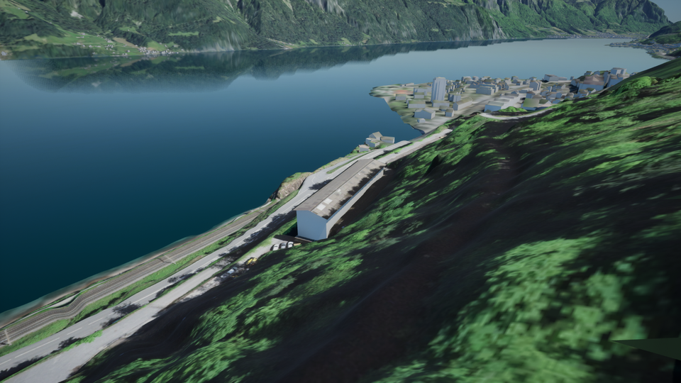

# Vermessene Gebäude am Walensee

Die Landschaft enthält 16.249 Gebäude aus swissBUILDINGS3D 3.0 Beta mit 978.500 Dreiecken. Die Gebäude behalten ihre vermessene Lage und Höhe in LV95/LN02. Sie erhalten eigene Dächer, Fassaden, Schatten und Kollision. Die vorhandene Landschaftsfläche von 22 × 13 km wird vollständig anhand der ausgewählten Quelldateien abgedeckt; ganze Gebäude am Rand bleiben erhalten.

## Herkunft und Darstellung

36 über die swisstopo-STAC-Schnittstelle ausgewählte CityGML-Dateien sind in `Content/Diving/Geodata/buildings_sources.json` mit URL, Produktjahr und offizieller SHA256-Prüfsumme festgeschrieben. Die verfügbaren Produktjahre sind 2019 und 2022. Das ist kein aktueller Gebäudebestand von 2026. Die Quellen enthalten Außenflächen und zusätzlich eine zweite Solid-Darstellung derselben Gebäude. Die Pipeline übernimmt ausschließlich die Außenflächen und verlangt für jede Solid-ID ein entsprechendes Flächenmodell; beide Varianten werden nicht übereinander importiert.

Die Dachflächen tragen die bereits registrierten SWISSIMAGE-Luftbilder von 2025. Drei örtliche Bildausschnitte haben höhere Auflösung als das Hintergrundbild. Fassaden erhalten neutrale, illustrative Farben. Fenster, Türen, Fassadenfotos, Innenräume und kleine Dachaufbauten werden nicht ergänzt. Die verschiedenen Aufnahmejahre können Abweichungen zwischen Dachgeometrie und Luftbild verursachen. Bereits fotografierte Schatten bleiben Bestandteil der Texturen.

Die Gebäudedaten werden weder vertikal auf das bestehende Geländemesh verschoben noch durch Kästen ersetzt. Unterschiede zum groben 8-m-Hintergrundgelände können deshalb am Gebäudesockel sichtbar bleiben. Fernes Gelände bleibt ohne begehbare Kollision; vorhandene Uferbereiche und Einstiegswege bleiben der unterstützte Spielbereich. Gebäude allein machen die gesamte Landschaft noch nicht begehbar.

Quellen: [swisstopo-Produktbeschreibung](https://www.swisstopo.admin.ch/de/landschaftmodell-swissbuildings3d-3-0-beta), [Nutzungsbedingungen](https://www.swisstopo.admin.ch/de/nutzungsbedingungen-kostenlose-geodaten-und-geodienste). Die Herkunft steht im Spielmenü und in `BUILDINGS_NOTICE.txt`, auch neben dem Windows-Paket.

## Aufbereitung und Laufzeit

`Tools/prepare_buildings.py` prüft jeden Download, liest Außenflächen samt Innenringen und trianguliert konkave Polygone einschließlich Löchern. Die Achsenabbildung bleibt X = Nord, Y = Ost, Z = Höhe minus 419 m; Unreal-Koordinaten sind Zentimeter. 512-m-Zellen halten die lokalen Float-Koordinaten klein. Die 715 `.bmesh`-Dateien umfassen insgesamt 50.887.720 Bytes; Manifest und Binärdateien enthalten Prüfsummen und Quellbezüge.

`DiveBuildingsBake` baut daraus 715 Nanite-Meshes mit einem Zentimeter Positionspräzision und vollständiger Fallback-Geometrie. Kollision verwendet die Dreiecksflächen des Fallbacks. Der Befehl prüft Quellpositionen, Topologie, Nanite-Daten und vorhandene Physikdreiecke. `BuildingsCheck` prüft vorhandene Assets ohne Neubau. Ein Paketbau verweigert fehlende oder veraltete Gebäudemeshes.

Alle Gebäudekomponenten werden beim Weltstart geladen; Nanite verwaltet die Geometrieseiten. Eigenes entfernungsabhängiges Entladen der Gebäudekomponenten ist noch nicht implementiert. Der normale Spielstart verwendet dieselbe Geometrie wie die Tests. Fehlende Daten führen zu einem Fehler statt zu Ersatzgebäuden.

## Reproduktion und Prüfung

```powershell
python -m pip install -r Tools/requirements-buildings.txt
python Tools/prepare_buildings.py
python Tools/validate_buildings.py
./Tools/Build.ps1 -Target Editor -EditorSandbox
./Tools/Build.ps1 -Target Content -OnlyBuildings -EditorSandbox
./Tools/Build.ps1 -Target Buildings -EditorSandbox
./Tools/Build.ps1 -Target BuildingsCheck -EditorSandbox
./Tools/Build.ps1 -Target Package -EditorSandbox -BuildSlot Buildings -PackageDirectory Builds/WindowsBuildings
./Tools/TestBuildings.ps1 -PackageDirectory Builds/WindowsBuildings
```

Vor der Materialerstellung müssen die bereits vorhandenen registrierten SWISSIMAGE-Texturassets geladen sein. Binärdateien und Unreal-Assets liegen in Git LFS. Der unabhängige Datenvalidator importiert keinen Aufbereitungscode: Er vergleicht sämtliche ausgegebenen Eckpunkte mit den ursprünglichen CityGML-Ecken, Flächeninhalte mit den Polygonringen, die Gebäudeabdeckung und alle Prüfsummen. Ergebnis: 36 Quellen, 16.249 Gebäude, 715 Zellen, 978.500 Dreiecke; maximale Koordinatenrundung 0,000075 m und maximale relative Flächenabweichung 0,00002077.

Sechs Python-Tests prüfen konkave Dächer, Innenhöfe, gedrehte Wände, Flächenorientierung, ungültige Koordinaten und doppelte Modellvarianten. Die gesamte Python-Suite umfasst 21 Tests. Die nativen Unreal-Tests umfassen weiterhin 30 Fälle. Jeder gerenderte Smoke-Test prüft außerdem Lage, Material und eine tatsächliche Kollisionsabfrage an jedem der 715 Gebäudemeshes.

`TestBuildings.ps1` umfasst zwölf Paketläufe: drei erhöhte Gebäudeansichten, einen Render-Fallback ohne Nanite, drei vollständige Uferwege, Sediment/Kopfdrehung, Avatar, Atmung, Handgelenkcomputer und Populations-Streaming. Die erhöhten Kameras sind ausdrücklich Prüfansichten und keine normalen Spielerpositionen. `ReportBuildings.py` prüft die erzeugten Protokolle und Bilder sowie die Übereinstimmung des Quellstands mit der Build-Sandbox; die Berichtsumgebung benötigt zusätzlich Pillow. Das vom Test ausgegebene Ergebnisverzeichnis wird als Argument übergeben.

## Geprüfter Paketstand

`Builds/WindowsBuildings/divingsim.exe` startet den getrennten Windows-Build. Zwölf Paketläufe bestehen mit 60 Bildschirmaufnahmen und einer Computertextur. Der vorherige HeadTurn-Build und die vorhandenen Avatar-/Ökologie-Assets bleiben unverändert. [BUILDINGS_RESULTS.json](BUILDINGS_RESULTS.json) enthält die unabhängige Datenprüfung, die 30 nativen Testergebnisse, den Quellabgleich, Bild- und Pakethashes sowie den Nachweis eines wiederholten Uferlaufs nach fehlender Aufnahme.

Zwei separate 60-Sekunden-Messungen bei 1080p, Qualität 2 und voller Renderauflösung erreichen am Murg-Ufer 96,9 FPS im Mittel / 78,1 FPS als 1%-Low und am Weesen-Seegrund 90,9 / 74,5 FPS. Sämtliche gemessenen Frames bleiben unter 16,67 ms. RTX 3090 / Ryzen 9950X3D; der Benutzer-Editor bleibt geöffnet, weitere Spielinstanzen laufen während dieser Messungen nicht. Die Routen belegen weder Mindesthardware noch die maximal sichtbare Gebäudedichte. Rohdatenbezüge und vollständige Messwerte: [BUILDINGS_PERFORMANCE.json](BUILDINGS_PERFORMANCE.json).

Der normale Starter besteht ebenfalls den Gameplay-Test und startet nachweislich die zugehörige EXE: [BUILDINGS_LAUNCHER.json](BUILDINGS_LAUNCHER.json).

## Offene Qualität



Verkleinerte Aufnahme aus dem Windows-Paket, aus einer erhöhten Prüfkamera. Die Dachgeometrie und die Ortschaft am Ufer sind räumlich vorhanden; Fassaden und umgebende Landschaft bleiben vereinfacht.

Diese Ergänzung verbessert die räumliche Ortsdarstellung. Die Nahansichten zeigen weiterhin gestreckte Luftbilder, grobe oder sichtbare Geländeübergänge und flache fotografierte Vegetation. Originalgetreue Zugangsanlagen, räumliche Bäume/Wälder, Fassadendetails, fotorealistische Gesamtqualität, Mindesthardware, natives macOS und die vollständige Spezifikationsabnahme bleiben offen.
