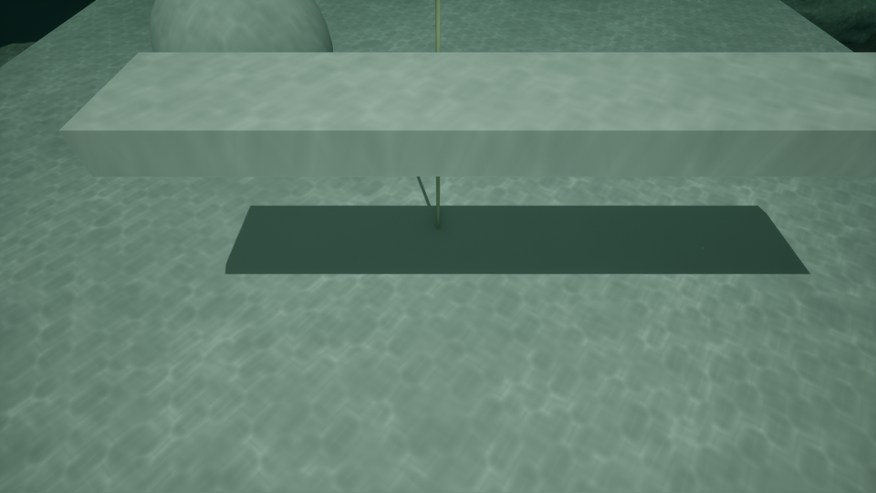
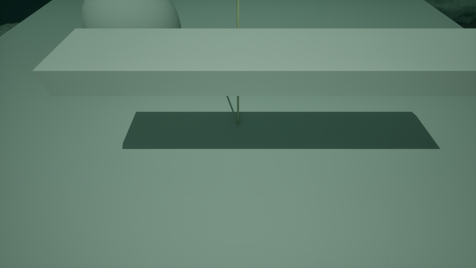

# Sonnenlicht und Caustics unter Wasser

WATR-006 verwendet jetzt eine Lichtfunktion auf der vorhandenen astronomischen Sonne. Sie erreicht undurchsichtige Unterwasseroberflächen einschließlich Boden, Felsen, Pflanzen, Fischen und Ausrüstung. Die bisherigen unabhängigen Sinusmuster in den Bodenfarben wurden entfernt. Das Material erzeugt kein zusätzliches selbstleuchtendes Licht: Die normale Sonnenbeleuchtung, Materialnormalen und dynamischen Schatten bestimmen weiterhin, welche Flächen Licht erhalten.

## Berechnung und Grenzen

`WaterOptics.ush` enthält die gemeinsamen Oberflächenableitungen für das Wassermaterial und die neue Lichtfunktion. Vier Wellen verwenden dieselben SI-Koeffizienten, Phasen und denselben Simulationszeitpunkt wie die Wasseroberfläche. Drei advectierte Rauschschichten liefern die bereits vorhandene feine Normalenstruktur; deren analytische zweite Ableitungen werden zusätzlich für die Bündelung berechnet. Diese Mikrostruktur ist optisches Normalendetail, keine zusätzliche Kollisionshöhe. Bei Windstille entfallen Wellen und Mikrostruktur.

Vom Empfänger wird zunächst ein Strahl durch eine ebene Wasserfläche zurückverfolgt. Zwei begrenzte Iterationen verfeinern den geschätzten Oberflächenpunkt. Der gebrochene Strahl verwendet das Snelliussche Gesetz mit einem konstanten Brechungsindex von 1,333. Die Ableitung der Strahlrichtung und die lokale Oberflächenkrümmung liefern die Jacobi-Determinante der Abbildung auf die Empfängertiefe. Ihr inverser Betrag dient als Näherung für die lokale Bündelung. Die physikalische Grundlage und der Unterschied zwischen vereinfachten Echtzeitverfahren und vollständiger Photonensimulation sind in [NVIDIA GPU Gems, Rendering Water Caustics](https://developer.nvidia.com/gpugems/gpugems/part-i-natural-effects/chapter-2-rendering-water-caustics) beschrieben; der Projektcode ist eine eigene Umsetzung.

Eine exponentielle Dämpfung mit `1,45 / Sichtweite` berücksichtigt den Weg des Sonnenlichts im Wasser. Das ist ein gestalteter, grauer Extinktionskoeffizient, keine gemessene spektrale Walensee-Optik. Die bisherige farbabhängige Dämpfung entlang des Blickstrahls bleibt separat erhalten. Eine Fresnel-Näherung reduziert den Eintrittsanteil. Die Bündelung ist auf 0,25–4 begrenzt. Ihr Kontrast nimmt zusätzlich mit `exp(-Weglänge × (1/18 + Extinktion))` ab: eine gestaltete Näherung für den Verlust gerichteter Strahlen durch Streuung. Der abschließende Lichtfaktor ist auf 0–1 begrenzt. Oberhalb der lokalen Wasserhöhe beträgt er 1. Die Lichtfunktion wirkt ausschließlich auf die Sonne; Mond und Tauchlampe erzeugen dadurch keine Sonnen-Caustics.

Es handelt sich um eine begrenzte Einzelstrahl-Näherung. Sie löst weder mehrere eintreffende Strahlen noch energieerhaltende Brennlinien, die Sonnenscheibe, Dispersion oder Brechung der Schattengeometrie. Die normale Oberflächenbeleuchtung und das bestehende Schattenverfahren verwenden weiterhin die ursprüngliche Sonnenrichtung; die Lichtfunktion verändert deren Stärke. Die feinen Wellen sind nur im Nahbereich geometrisch dargestellt; ihre Kollisions- und Renderinggrenzen bleiben unverändert. Die Umsetzung ist kein Nachweis einer fotorealistischen oder radiometrisch richtigen Gesamtbeleuchtung.

Unreal-Lichtfunktionen filtern die Beleuchtung undurchsichtiger Oberflächen. Die verwendete Weltposition erfordert den normalen Lichtfunktionspfad; der Atlas ist dafür nicht geeignet. Grundlagen und Einschränkungen: [Epic, Light Functions](https://dev.epicgames.com/documentation/en-us/unreal-engine/using-light-functions-in-unreal-engine). Die Integration wurde zusätzlich gegen die lokal installierten UE-5.8.4-Shader geprüft. Transparente Atemblasen, Spiegelungen und indirekte Beleuchtung erhalten damit keine vollständige brechungsbasierte Caustic-Simulation. Hardware-Raytracing ist für die neue Lichtfunktion nicht erforderlich.

## Kontrollierte Bildprüfung

`TestCaustics.ps1` startet für Tag, Windstille, Nacht, Luft und 15 m Tiefe jeweils eine eigene Szene. Synthetische matte Empfänger, eine Kugel und ein Schattenwerfer liegen nur in diesen Diagnosefällen im See. Jeder Start wartet auf die Beleuchtung und liefert vier Bilder: Muster an, Muster aus, Muster zu einem zweiten Wellenzeitpunkt, Wiederholung desselben festgehaltenen Zeitpunkts. Beim Abschalten bleibt die normale Wasserdämpfung aktiv. ISO, Blende, Belichtungszeit und Belichtungskorrektur bleiben für alle Fälle gleich.

`ReportCaustics.py` vergleicht festgelegte innere Bildbereiche der beleuchteten Fläche, des Schattens und der Kugel. Tagsüber müssen Fläche und Kugel ein erkennbares zeitabhängiges Muster zeigen. Schatten, Windstille, Nacht und Luft dürfen kein vergleichbares zusätzliches Muster erhalten. Der festgehaltene Zeitpunkt muss bis auf zeitliches Renderrauschen stabil bleiben. Die RGB8-Differenzen sind Bildprüfungen, keine Messungen realer Strahlungsleistung. Normale Spielabläufe und Leistung werden zusätzlich im Windows-Paket geprüft.

Direkte Aufnahmen des Windows-Pakets, nur verkleinert. Beide Bilder verwenden dieselbe Kamera, Wellenzeit, Belichtung und Wasserdämpfung. Die künstlichen Empfänger dienen ausschließlich der Diagnose und erscheinen nicht im normalen Spiel.

| Caustic-Muster eingeschaltet | Muster ausgeschaltet |
|---|---|
|  |  |

Alle fünf Paketfälle bestehen mit insgesamt 20 frischen Bildern. Die mittlere absolute RGB8-Differenz beim Umschalten beträgt auf der beleuchteten Fläche 4,14 bei 3,2 m Tiefe und 1,46 bei 15 m. Auf der Kugel sind es im flachen Wasser 3,41, im Schatten 0,30. Windstille und Luft liegen mit 0,32 beziehungsweise 0,33 im Bereich des Renderrauschens; nachts ist die Differenz null. Der zweite Wellenzeitpunkt verändert die beleuchtete Fläche um 5,90, seine festgehaltene Wiederholung nur um 0,35. Kamerapositionen, Zustände, Bild-, ausführbare Datei- und Paketarchiv-Hashes stehen in [CAUSTICS_RESULTS.json](CAUSTICS_RESULTS.json).

Ein erster Tiefenvergleich zeigte trotz mittlerer Dämpfung zu ausgeprägte Brennlinien. Die zusätzliche sichtweitenabhängige Kontrastdämpfung wurde deshalb vor dem abschließenden Paketlauf ergänzt. Die berichteten fünf Fälle verwenden durchgehend den korrigierten Materialstand und dieselbe feste Belichtungskorrektur von −4,6.

Der bewegte Tauchtest deckte außerdem eine Abweichung zwischen Physik- und Welt-Tick auf: Der Sonnenstand wurde innerhalb der Physikschritte schon aktualisiert, der Lichtfunktionsstrahl noch nicht. `UpdateDaylight` veröffentlicht jetzt unmittelbar den zugehörigen Strahl und die gemeinsame Wellenzeit. Die Prüfung behält ihre enge Richtungs- und Zeitkontrolle bei; ihre Toleranz wurde nicht aufgeweicht.

## Spielprüfung und Leistung

Im gleichen Windows-Paket bestehen sieben normale Spielabläufe: Tauchen, Nacht mit Handgelenkcomputer, Regen an der Oberfläche, Uferstart, Sediment, Populationsstreaming und Tageszeitwechsel. Sie liefern 31 weitere frische Bilder. Die Sediment- und Tageszeitprüfungen erfassen auch tatsächliches Pausieren; die festgehaltene Diagnosezeit allein wäre dafür kein Nachweis. Alle 30 nativen Unreal-Tests, die deterministischen C++-Kernprüfungen und 21 Python-Tests bestehen. Der normale Programmstarter startet die erwartete ausführbare Datei und beendet den automatischen Tauchgang erfolgreich. Der vorherige Build `WindowsShoreSeams` bleibt einschließlich seiner Paketarchive unverändert. Dateiidentitäten und Ergebnisse: [CAUSTICS_BUILD.json](CAUSTICS_BUILD.json), [CAUSTICS_LAUNCHER.json](CAUSTICS_LAUNCHER.json).

Zwei getrennte 60-Sekunden-Messungen bei 1920 × 1080, Qualität 2 und 100 % Renderauflösung ergeben am Ufer 96,69 FPS im Mittel und 79,21 FPS im langsamsten Prozent; unter Wasser sind es 83,70 beziehungsweise 65,84 FPS. Die längsten Bilder benötigen 13,64 und 16,35 ms. Kein Bild überschreitet 16,67 ms. Gemessen wurde auf RTX 3090 / Ryzen 9950X3D bei geöffnetem Benutzer-Editor und ohne weitere Spielinstanz. Das sind zwei kurze Strecken, kein isolierter Vorher-/Nachher-Vergleich, keine Mindesthardwarefreigabe und kein Langzeittest. Messdaten und Prozesskontext: [CAUSTICS_PERFORMANCE.json](CAUSTICS_PERFORMANCE.json).

```powershell
./Tools/Build.ps1 -Target Editor -EditorSandbox
./Tools/Build.ps1 -Target Content -OnlyCaustics -EditorSandbox
./Tools/Build.ps1 -Target Content -OnlyWater -EditorSandbox
./Tools/Build.ps1 -Target Content -OnlyBed -EditorSandbox
./Tools/Build.ps1 -Target Package -EditorSandbox -BuildSlot Caustics -PackageDirectory Builds/WindowsCaustics
./Tools/TestCaustics.ps1 -PackageDirectory Builds/WindowsCaustics -Case day
```

Weitere Fälle: `calm`, `night`, `air`, `deep`. Das Berichtswerkzeug erhält die ausgegebenen Ergebnisordner als Argumente und benötigt NumPy und Pillow. Native macOS-Spielprüfung, Mindesthardware und visuelle Gesamtabnahme bleiben offen.
