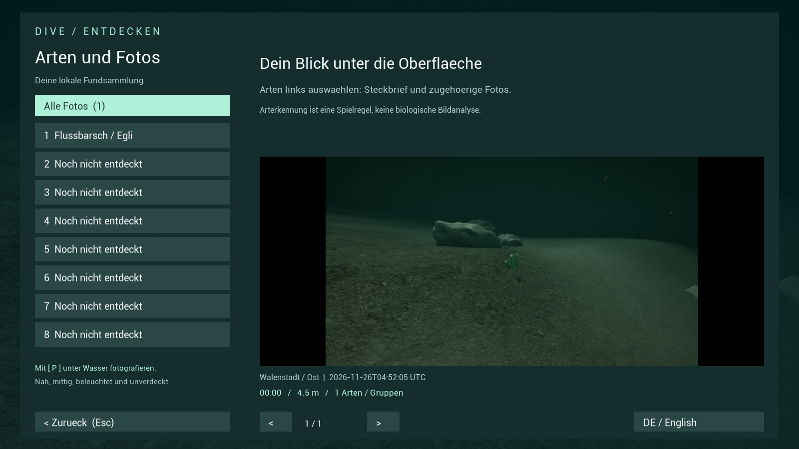

# Spielbare Uferergänzung

Stand 26.11.2026. Das separate Paket **`Builds/WindowsCoast/divingsim.exe`** verbindet die bisher fehlenden Uferbereiche mit dem vermessenen Seegrund. An den Wasserstarts Weesen, Murg und Walenstadt kann der Taucher über die frühere Vermessungsgrenze schwimmen und zurückkehren. Die Tiefe der Ergänzungen ist modelliert; die Tiefenkarte und die Prüfung für neue Wegpunkte verwenden weiterhin ausschließlich vermessene Daten.



Die neue Aufnahme stammt aus der automatischen Fisch-Fotoansicht des fertigen Pakets. Die zuvor sichtbare ausgeschnittene Bodenfläche ist geschlossen. Der frühere Befund bleibt in [DISCOVERIES.md](DISCOVERIES.md) dokumentiert. Die Aufnahme ist keine fotorealistische Gesamtabnahme.

## Gelände und Bewegung

Die unabhängig geprüften 644 Quellkacheln ergeben 496 neue Nanite-Meshes mit 11.413.310 Dreiecken. Vollständig vermessene Dreiecke bleiben im bestehenden Nahbereichs-Streaming. Die drei Einstiegspatches behalten ihre Flächen. Die Ergänzungen erzeugen jeweils nur die übrigen Dreiecke; ihre Kollision verwendet die vollständige Fallback-Geometrie. Die 77 Hintergrund-Landschaftsmeshes werden mit passenden Aussparungen neu erzeugt. Datenherkunft, Inseln, Interpolation und Herkunftskennungen: [COAST_MODEL.md](COAST_MODEL.md).

Alle nahen Bodenflächen liegen auf demselben 1-m-Eckpunktraster und verwenden dieselbe Diagonale. Die physische Bodenabfrage interpoliert diese Dreiecksebenen. An der Außengrenze zur 8-m-Hintergrundlandschaft und an den bisherigen Einstiegspatches wird ein 32-m-Übergangsband verwendet. Neue Uferkacheln blenden nicht an ihren gegenseitigen Grenzen ab. Die Übergänge erhalten eine gemeinsame Normalenberechnung; das Unterwassermaterial ist dasselbe wie beim vermessenen Grund. Oberhalb des Wassers wird das registrierte regionale Luftbild verwendet.

Die Schwimmbewegung verwirft Positionen nicht mehr allein deshalb, weil dort keine originale Tiefenmessung vorliegt. Sie verlangt eine gültige begehbare Oberfläche und bleibt gegen die tatsächlichen Gelände- und Objektkollisionen geprüft. Auch die Sedimentquelle erkennt die neuen Bodenmeshes. Aufgewirbelte Wolken werden über der physischen Oberfläche weitergeführt, statt beim Erreichen eines unvermessen gebliebenen Bereichs zu verschwinden.

Menü und mitgelieferte `COAST_NOTICE.txt` benennen die modellierten Uferbereiche und die zusätzliche Quelle swissTLM3D. Das vorherige Paket `WindowsDiscoveries` bleibt unverändert.

## Nachweise

- 35 native Unreal-Tests, beide portablen C++-Prüfprogramme und 28 Python-Tests bestehen.
- Neun Paketabläufe erzeugen 56 frische Aufnahmen. Die Grenzüberquerungen laufen bei Weesen in 1600 × 900, bei Murg in 1920 × 1080, bei Walenstadt in 4K und dort zusätzlich ohne Nanite in 1280 × 1024. Alle kehren auf vermessenen Grund zurück.
- Jeder Paketlauf prüft einen echten Kollisionskontakt für jedes der 496 Ufermeshes. Die Höhe wird mit der gemeinsamen Bodenabfrage verglichen; zulässige Abweichung ist 2 cm.
- Die drei Überquerungsrouten verwenden reguläre simulierte Tasteneingaben nach einer anfänglichen Positionierung. Eine separate kontrollierte Flossenpositions-Probe erzeugt jeweils sieben Sedimentwolken auf dem unvermessen gebliebenen Grund und prüft, dass sie nach dem Simulationsschritt noch existieren. Das ist kein Nachweis eines realen Tastatur- oder Flossentests durch eine Person.
- Die drei bisherigen Uferwege einschließlich Rückkehr und Abschluss sowie Fotosammlung und Steuerung bestehen. Der Mesh-Build prüft die Quelldreiecke, gespeicherten Eckpunkte, Nanite-Daten und vollständige Kollisionsgeometrie. 136 Quell-/Konfigurationsdateien stimmen mit dem kompilierten Sandbox-Stand überein; 574 erzeugte Gelände-/Materialassets sind über Prüfsummen gebunden.

Maschinenlesbare Nachweise: [Paketabläufe](COAST_RESULTS.json), [Build und Quellen](COAST_BUILD.json), [Datenprüfung](COAST_MODEL_AUDIT.json). Die Bildprüfung zeigt geschlossene Bodenflächen in den geprüften Grenzansichten. Unscharfe bzw. gestreckte Luftbilder an Steilhängen und flach abgebildete Vegetation bleiben deutlich sichtbar.

## Programmstart und Leistung

Der normale Root-Starter startet nachweislich das zugehörige Coast-Spielprogramm und beendet den automatischen Tauchgang erfolgreich: [Starterprüfung](COAST_LAUNCHER.json). Zwei Messungen mit jeweils 15 Sekunden Aufwärmzeit und 60 Sekunden Erfassung verwenden 1920 × 1080, Qualität 2 und 100 % Renderauflösung ohne dynamische Skalierung oder FPS-Limit. Auf Ryzen 9 9950X3D und RTX 3090 mit weiterhin geöffnetem Benutzereditor ergeben sich:

| Szene | Mittel | Langsamstes 1 % | Maximale Bildzeit | Gemessene Bilder |
|---|---:|---:|---:|---:|
| Unter Wasser, Weesen | 84,96 FPS | 67,93 FPS | 15,41 ms | 5.096 |
| Am Ufer, Murg | 96,54 FPS | 78,39 FPS | 13,94 ms | 5.790 |

Kein erfasstes Bild überschreitet 33,33 ms. Dies sind kurze Szenenmessungen auf dem Entwicklungsrechner, keine Mindesthardware- oder Langzeitfreigabe. Originalmetadaten, Hintergrundprozesse, Bildzeitstatistik und Prüfsummen: [COAST_PERFORMANCE.json](COAST_PERFORMANCE.json).

## Reproduktion

Nach einem vollständigen Git-LFS-Checkout sind Quellraster und erzeugte Unreal-Assets vorhanden. Nur bei einer erneuten Datenaufbereitung werden die ursprünglichen GeoTIFFs und die Python-Geodatenumgebung benötigt.

```powershell
./Tools/Build.ps1 -Target Editor -EditorSandbox
./Tools/Build.ps1 -Target Coast -EditorSandbox
./Tools/Build.ps1 -Target Landscape -EditorSandbox
./Tools/Build.ps1 -Target Package -EditorSandbox -BuildSlot Coast -PackageDirectory Builds/WindowsCoast
./Tools/TestCoast.ps1 -PackageDirectory Builds/WindowsCoast
```

Die Paketierung verweigert fehlende oder veraltete Ufermeshes. Bei einer Änderung am Ufermaterial ist vorher `-Target Content -OnlyShore` erforderlich. Die Build-Sandbox erhält die geladene Editor-DLL des Benutzers; die erzeugten Content-Assets werden im Projekt gespeichert.

Die Ergänzungen sind geschätzte Spielflächen. Feinere Ufergeometrie, räumliche Vegetation, originalgetreue Zugänge, eine vollständige Uferbefahrung, Langzeitprüfung dieses Builds, Mindesthardware und ein natives macOS-Spiel bleiben offen. Fisch- und Pflanzenplatzierung sowie die Kartenmarkierungen sind weiterhin an die vermessenen Bereiche gebunden. Die vollständige Anforderungsabnahme ist nicht abgeschlossen.
