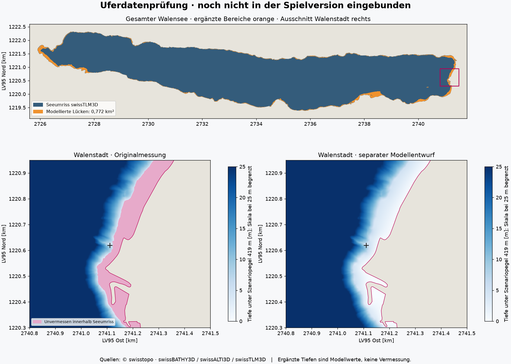

# Walensee: vorbereitete Uferergänzung

Stand 26.11.2026: Die separate Datenaufbereitung für den gesamten See ist erzeugt und geprüft. **Sie ist noch nicht in Unreal eingebunden.** Das spielbare Paket `Builds/WindowsDiscoveries` bleibt unverändert; die sichtbare offene Bodenkante bei Walenstadt und die Begrenzung der Bewegung am Vermessungsrand bleiben dort bestehen.



Die Abbildung zeigt Höhenraster, keinen Spiel-Screenshot. Rosa bezeichnet die unvermessene Fläche innerhalb des offiziellen Seeumrisses. Rechts ist der separate Modellentwurf dargestellt; das Kreuz markiert den bisherigen Walenstadt-Wassereinstieg. Die Tiefenskala ist bei 25 m begrenzt. Die Landfläche ist für diese Diagnose einfarbig hinterlegt.

## Quellen und Verfahren

Der Seeumriss stammt aus [swissTLM3D](https://www.swisstopo.admin.ch/de/landschaftsmodell-swisstlm3d), festgeschriebene Ausgabe `2026-02`, Objektgruppe `TLM_STEHENDES_GEWAESSER`, `GEWISS_NR=9267`. Die 75 Linien bilden vier geschlossene Ringe: den Außenrand und drei Inselkonturen. Die Ausgabe enthält für diese Objekte Revisionsjahre 2019 und 2022; 2026 ist nicht das Aufnahmejahr der gesamten Uferlinie. Fläche des Polygons: 24.106.087,353 m². Koordinaten: LV95 / LN02, EPSG:2056 / EPSG:5728. Herkunft und SHA-256-Prüfsummen: [WALENSEE_COAST_SOURCE.json](WALENSEE_COAST_SOURCE.json). Attribution: © swisstopo; [Nutzungsbedingungen](https://www.swisstopo.admin.ch/de/nutzungsbedingungen-kostenlose-geodaten-und-geodienste).

Die bestehenden 46 swissBATHY3D-Raster und 68 für den Ausschnitt benötigte native 2-m-swissALTI3D-Kacheln liefern die Höhen. Der Szenariopegel bleibt 419 m LN02. Alle Daten werden auf gemeinsame 1-m-Zellmittelpunkte bezogen. Originale bathymetrische Zellen haben Vorrang, auch bei den 138 gemessenen Zellen außerhalb des anders datierten Seeumrisses. Fehlende Tiefen werden nur innerhalb des Polygons einschließlich seiner ausgesparten Inseln ergänzt. Dadurch werden angrenzende, ebenfalls unter 419 m liegende Flächen nicht irrtümlich zum See erklärt.

Für die 771.759 unvermessen gebliebenen Seezellen wird eine gemeinsame Laplace-Gleichung mit vier Nachbarn gelöst. Gemessene Tiefen und Landhöhen sind feste Randwerte. Für die Gleichung werden positive landseitige Randwerte auf den Wasserspiegel begrenzt, damit keine künstlichen Spitzen aus dem Wasser entstehen; die gespeicherten Original-Landhöhen bleiben erhalten. Die Lösung wird anschließend in 634 Kacheln mit 128 × 128 m Kernfläche und einem zusätzlichen Zellrand pro Seite aufgeteilt. Benachbarte Kacheln verwenden dieselben berechneten Werte.

Jede gespeicherte Zelle hat eine Herkunftskennung:

| Kennung | Bedeutung |
|---|---|
| 1 | Ursprünglicher swissBATHY3D-Wert, nur in float32 dargestellt |
| 2 | Native swissALTI3D-Landhöhe außerhalb des Seeumrisses, bilinear von 2 m auf 1 m abgetastet |
| 3 | Modellierte Lücke innerhalb des Sees, keine vermessene Tiefe |

Die Ausgabe enthält die Lücken und einen Uferstreifen, nicht noch einmal das gesamte vermessene tiefe Seebecken. Die Binärdaten liegen lokal unter `Geodata/Processed/Coast` (53.573.000 Bytes), einschließlich eines eigenen Manifests mit allen Quellen- und Ausgabeprüfsummen. Dieser Zwischenstand wird noch nicht als Laufzeit-Content versioniert. Das Originalraster, seine NoData-Zellen, die bisherigen drei Einstiegspatches und bestehende Pakete wurden nicht verändert.

## Prüfung

[COAST_MODEL_RESULTS.json](COAST_MODEL_RESULTS.json) beschreibt die Erzeugung; [COAST_MODEL_AUDIT.json](COAST_MODEL_AUDIT.json) hält die unabhängige Prüfung der geschriebenen Dateien fest:

- Alle 771.759 fehlenden Seezellen sind abgedeckt; keine modellierte Zelle liegt außerhalb des Seeumrisses oder auf einer Insel.
- 4.581.707 gespeicherte Messzellen stimmen mit den Originalrasterwerten überein.
- 52.734 Landzellen wurden direkt aus jeweils vier nativen GeoTIFF-Zellwerten unabhängig nachgerechnet, einschließlich Quellkachelgrenzen. Maximale Abweichung: 0 m in float32.
- 245.992 überlappende Randzellen sind zwischen den Ausgabekacheln bitgleich.
- Die gespeicherten Werte erfüllen die Interpolationsgleichung mit maximal 0,000001431 m numerischem Restfehler. Das ist **keine Aussage zur Genauigkeit der geschätzten Wassertiefe**.
- Sieben neue Tests prüfen eine analytisch bekannte Ebene, feste Messwerte, Inseln, tief liegendes Nachbarland, positive Uferhöhen, ungültige Eingaben sowie Kachelränder und Koordinaten. Die gesamte Python-Suite umfasst nun 28 bestandene Tests.

## Reproduktion

Voraussetzung sind die vorhandenen bathymetrischen Laufzeitdaten und die ursprünglichen swissALTI3D-GeoTIFFs samt `Geodata/Raw/Landscape/catalog.json`. Der Grenzdownload liest nur die benötigten ZIP-Mitglieder über HTTP-Bytebereiche; das nationale 3,59-GB-Archiv muss nicht vollständig geladen werden. Versionierte SHA-256-Werte sichern die Quellen.

```powershell
Tools/.geodata-env/Scripts/python.exe -m pip install -r Tools/requirements-coast.txt
Tools/.geodata-env/Scripts/python.exe Tools/download_lake_boundary.py
Tools/.geodata-env/Scripts/python.exe Tools/prepare_coast.py
Tools/.geodata-env/Scripts/python.exe Tools/validate_coast.py
Tools/.geodata-env/Scripts/python.exe -m unittest discover -s Tests -p "test_*.py"
# Optionaler Diagnoseplot; benötigt zusätzlich matplotlib.
Tools/.geodata-env/Scripts/python.exe Tools/plot_coast.py
```

Die CI benötigt für die synthetischen Tests nur `requirements-coast-model.txt`; sie lädt keine nationalen Geodaten und ersetzt den lokalen Datenaudit nicht.

## Offene Integration

Vor einem neuen spielbaren Paket müssen die Ergänzungen mit der tatsächlich gerenderten Geometrie und den Kollisionsabfragen verbunden werden. Die bisherige reine Vermessungsabfrage muss für Karte und Herkunftsangaben erhalten bleiben. Gemessener Seegrund, neue Ergänzungen und vorhandene Einstiegspatches benötigen eindeutige Zuständigkeiten pro Dreieck, damit weder Löcher noch doppelte Flächen entstehen. Der Anschluss an das gröbere Landschaftsmesh muss entlang dessen tatsächlicher Dreiecksebenen erfolgen; ein separater Höhenübergang an jeder 128-m-Kachel würde künstliche Rinnen erzeugen.

Die Quellen unterscheiden sich in Aufnahmezeit und Auflösung. Kleine Uferbauten, Stufen und Steilwände sind durch diese Interpolation nicht rekonstruiert. Bewegung über den bisherigen Rand, Übergänge an allen drei Einstiegen, Walenstadt aus der bisherigen Fehleransicht, längere Uferfahrten, Kollision und Leistung benötigen danach eine neue Prüfung im gerenderten Paket. Keine dieser Abnahmen wird durch die vorliegende Datenprüfung als erledigt markiert.
