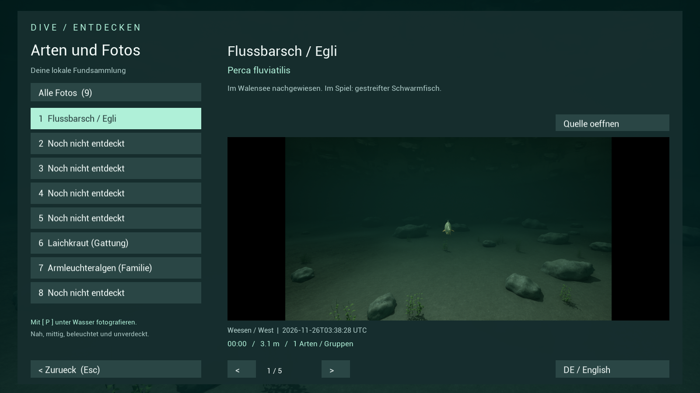
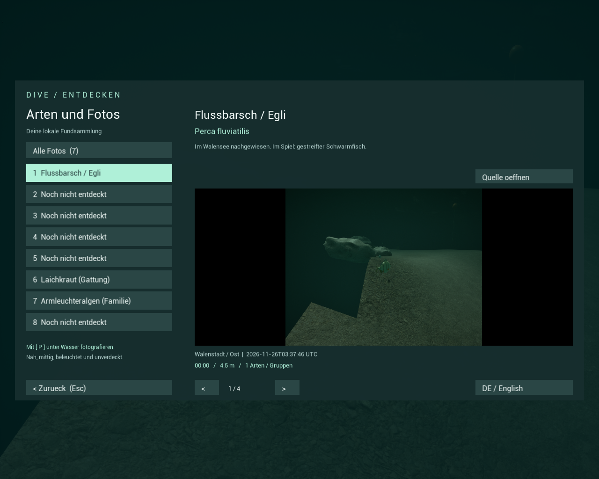

# Arten entdecken und fotografieren

Während eines laufenden Tauchgangs speichert **P** eine Aufnahme ohne Bildschirm-HUD. Die Fotoaktion bleibt frei belegbar. **Arten und Fotos** unten rechts im Start-/Pausenmenü öffnet die lokale Sammlung. Im Logbuch führt **Fotos / Arten** zur Auswahl des einzelnen Tauchgangs. Links lassen sich freigeschaltete Steckbriefe auswählen, rechts die zugehörigen Bilder durchblättern. Escape kehrt zur vorherigen Menüansicht zurück. Die Sammlung pausiert einen laufenden Tauchgang.

Die acht Einträge entsprechen den vorhandenen fünf Fisch- und drei Pflanzen-/Algenmodellen. Felchen bleiben eine Artengruppe, Laichkraut und Tausendblatt Gattungen, Armleuchteralgen eine Familie. Die Steckbriefe unterscheiden belegte Namen von Aussagen über das Spielmodell. Quelle und wissenschaftliche Bezeichnung stehen bei einem freigeschalteten Eintrag bereit; **Quelle öffnen** öffnet den jeweiligen Originalbeleg im Browser. Die Beschreibungstexte werden als UTF-8-Katalog mit dem Paket ausgeliefert.

Die fünf Fischgruppen und ihre Bezeichnungen sind im [Eawag-Bericht Projet Lac Walensee, 2014](https://www.fischereiberatung.ch/fileadmin/sites/fiber/angebot/andere_publ/projet_lac/projet_lac_walensee.pdf) dokumentiert. Die Pflanzengruppen folgen InfoFlora: [Potamogeton](https://www.infoflora.ch/de/flora/potamogeton.html), [Myriophyllum](https://www.infoflora.ch/de/flora/myriophyllum.html), [Characeae](https://www.infoflora.ch/de/flora/armleuchteralgen.html). Daraus wird keine vermessene lokale Pflanzenverteilung abgeleitet. Die Bilder in der Sammlung sind eigene Spielaufnahmen; es wurden keine Referenzfotos aus diesen Quellen übernommen.



## Wann eine Entdeckung zählt

Die Aufnahme prüft die vorhandenen Weltobjekte. Der Objektmittelpunkt muss unter Wasser, in einem engen Kegel um die Blickmitte, höchstens 12 m beziehungsweise 60 % der eingestellten Sichtweite entfernt und hinreichend groß im Blickfeld sein. Die Richtungsgrenze beträgt einen Skalarproduktwert von 0,97; Objektgröße/Entfernung muss mindestens 0,025 erreichen. Diese bewusst konservativen Schwellen sind gestaltete Spielregeln.

Hinzu kommen Umgebungslicht oder der innere Lichtkegel der eingeschalteten Lampe. Die Lampenprüfung berücksichtigt Lichtleistung, Entfernung und Wasserabschwächung. Eine Sichtlinie gegen die tatsächliche Umgebungskollision verhindert Entdeckungen durch Gelände und Felsen. Dichte lokale Sedimentwolken entlang des Strahls sperren die Entdeckung. Jede Artengruppe erscheint höchstens einmal pro Foto. Ein Foto ohne erkannten Eintrag ist ebenfalls zulässig.

Das ist eine Prüfung anhand von Objektpositionen, Größen und Sichtlinien, keine Analyse der gespeicherten Pixel. Körpermittelpunkte und Pflanzenhüllen ersetzen keine genaue Silhouettenprüfung; andere Tiere, transparente Blasen und einzelne Pflanzenblätter sind keine vollständigen Verdeckungsmasken. Animierte Geometrie kann vom Prüfpunkt abweichen. Die vorhandenen Modelle werden durch diese Funktion weder fotorealistisch noch anatomisch neu validiert.

## Speicherung und Fehlerfälle

PNG-Dateien liegen unter `Saved/Photographs/<GUID>.png`. Eine vollständige GUID verhindert Kollisionen bei schnell aufeinanderfolgenden Aufnahmen. Während eine Bildschirmaufnahme aussteht, wird keine zweite angefordert. Die Erfolgsmeldung und Entdeckungsdaten entstehen erst nach dem Screenshot-Callback und dem erfolgreichen Schreiben der Bilddatei. Das HUD wird während der Aufnahme verborgen; körperlich dargestellte Ausrüstung bleibt Teil der Szene.

Logschema **7** ergänzt `photographs`: Foto-ID, UTC-Aufnahmezeit, Simulationssekunden, Tiefe und stabile Artenkennungen. Das Logbuch bleibt die gemeinsame Datenquelle für Tauchgang und Sammlung. Der aktuelle Tauchgang ergänzt noch nicht abgeschlossene Speichervorgänge aus seinem Arbeitsspeicher; doppelte Foto-IDs werden in der Gesamtansicht zusammengeführt. Die vorhandene asynchrone, begrenzte Logschreibwarteschlange und validierte Sicherungsdatei werden weiterverwendet. Der Screenshot löst einen Zwischenstand aus; ein Dateisystemfehler beim späteren Logschreiben wird gesondert angezeigt. Ein Programmabbruch vor diesem Schreibabschluss kann eine PNG ohne Logzuordnung hinterlassen.

Ein Tauchgang darf bis zu 1000 Fotos enthalten. Der Leser prüft eindeutige GUIDs, Reihenfolge, Zeit- und Tiefengrenzen sowie bekannte, nicht doppelte Artenkennungen. Frei eingegebene Dateipfade werden nicht aus Logs übernommen. Die Vorschau akzeptiert begrenzte PNG-Dateien bis 64 MiB und 16 Megapixel. Ein fehlendes oder nicht lesbares Bild zeigt einen Hinweis; seine gespeicherten Funddaten bleiben erhalten. Die Logformate 1–6 bleiben ohne erfundene Fotodaten lesbar. Alte unzugeordnete PNGs werden nicht nachträglich einem Tauchgang zugewiesen.

Die Speicherung bleibt lokal zum jeweiligen Build. Zwischen bestehenden Paketordnern gibt es keine automatische Migration. Testaufnahmen liegen separat unter `Saved/PhotographsTest`; Testtauchgänge werden in der normalen Sammlung ausgefiltert.

## Prüfung

```powershell
./Tools/Build.ps1 -Target Editor -EditorSandbox
./Tools/Build.ps1 -Target Package -EditorSandbox -BuildSlot Discoveries -PackageDirectory Builds/WindowsDiscoveries
./Tools/TestDiscoveries.ps1 -PackageDirectory Builds/WindowsDiscoveries
```

`DiveSim.Discoveries` prüft Identitäten, ungültige Pfade, doppelte/ungeordnete Datensätze, Kameragrenzen, Katalog und die Logzuordnung. Der Spieltest positioniert eine angehaltene Testkamera bei tatsächlich erzeugten Fischen und Pflanzen; er erzeugt keine zusätzlichen Ersatztiere. Künstliche Verdunkelung, gezieltes Lampenlicht, Sichtweitenbegrenzung, ein vorübergehender Kollisionskörper und ein dichter Sedimentpuff prüfen die Sichtbedingungen. Die Testkamera lädt die Geländekacheln am Aufnahmeort vorab. Die Renderaufnahmen selbst verwenden die gewöhnliche Umgebung. Dieser Test ist kein Nachweis eines durchgespielten natürlichen Suchvorgangs.

Die 14 Bedienphasen prüfen Aufnahme, gleichzeitige Anfrage, Sammlung, Sprachwechsel, Hitboxen, Logzuordnung und Rückkehr. Drei Einstiege verwenden 1600 × 900, 3840 × 2160 und 1280 × 1024. Ein eigener Neustartprozess lädt die gespeicherten Fotos erneut. Regressionsfälle prüfen Wegpunkte, Logkurven, Steuerung, Uferablauf und den normalen Tauchgang. Alle 35 nativen Tests, die Kernprüfungen, 21 Python-Tests, drei Paketfälle samt Neustart, fünf Regressionen und der normale Programmstarter bestehen. Die 22 Foto-/Sammlungsbilder und 30 Regressionsbilder sind mit Prüfsummen erfasst: [DISCOVERY_RESULTS.json](DISCOVERY_RESULTS.json), [DISCOVERY_BUILD.json](DISCOVERY_BUILD.json), [DISCOVERY_LAUNCHER.json](DISCOVERY_LAUNCHER.json). Der vorherige Wegpunkt-Build bleibt unverändert.

Dieses Inkrement setzt BIOL-014, NAV-008, LOG-008 und LOG-009 für die vorhandenen Modellgruppen um und erweitert NAV-007. Eine vollständige Artenbestimmung, bessere Tier-/Pflanzenmodelle, native macOS-Spielprüfung und die Gesamtabnahme der Spezifikation bleiben offen. Es wird keine neue Langzeit- oder Leistungsmessung aus den kurzen Bedienprüfungen abgeleitet.

## Gelände-Befund im damaligen Paket

Der folgende Befund dokumentiert das unverändert erhaltene Paket `WindowsDiscoveries`. Im neueren Paket `WindowsCoast` ist die ausgeschnittene Bodenfläche durch modellierte Ufergeometrie geschlossen; Umsetzung, neue Aufnahme und geprüfte Grenzüberquerungen stehen in [COAST.md](COAST.md). Die seeweite Datenaufbereitung ist unter [COAST_MODEL.md](COAST_MODEL.md) dokumentiert.

Die Aufnahme am östlichen Einstieg zeigt eine harte offene Bodenbegrenzung. Sie bleibt auch nach dem vollständigen Nachladen der örtlichen Geländekacheln sichtbar. Im 151 × 151 m großen Rasterfenster um diesen Einstieg sind 10.690 der 22.801 Zellen unvermessen; die vorhandene Bodenpipeline lässt solche Zellen aus. Diese Datenlücken und ihre sichtbaren Übergänge sind durch die Fotofunktion nicht behoben. Die Funktionsprüfungen gelten nicht als visuelle Abnahme dieser Landschaft.


