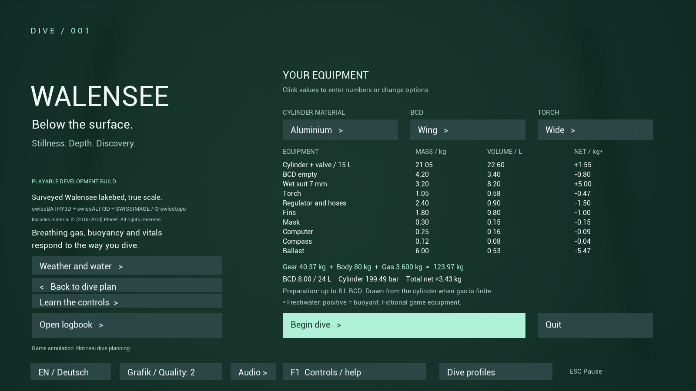

# Equipment mass and buoyancy

The equipment page lists every modeled item, its dry mass, displaced volume and freshwater net lift. Steel/aluminium cylinders, Jacket/Travel/Wing BCDs, wet/dry suits, three torches and ballast affect the same simulation. Selected material and BCD persist in settings and named profiles. During a dive the page displays the current state and locks equipment changes.

These are authored generic game presets, not replicas of commercial equipment. Mass, capacity and dimensions differ between real products; the catalog does not establish real pressure ratings or a safe weighting prescription. Separate 3D cylinder/BCD variants, a complete diver body, suit gas control and commercial-product validation remain open.

## Catalog

| Assembly | Dry kg | Solid displaced L | Additional volume |
|---|---:|---:|---|
| Steel cylinder including valve, capacity V | 1.15 V + 1 | V + (mass − 0.8)/7.8 + 0.1 | Cylinder gas adds mass only |
| Aluminium cylinder including valve, capacity V | 1.35 V + 0.8 | V + (mass − 0.8)/2.7 + 0.1 | Cylinder gas adds mass only |
| Jacket / Travel / Wing | 3.3 / 2.2 / 4.2 | 2.7 / 1.8 / 3.4 | Gas capacity 18 / 12 / 24 L |
| Dry / wet 7 mm suit | 4.5 / 3.2 | 3 / 2 | Compressible 4.5 / 6.2 L at the surface |
| Allround / Spot / Wide torch | 0.65 / 0.48 / 1.05 | 0.35 / 0.27 / 0.58 | None |
| Regulator and hoses | 2.4 | 0.9 | None |
| Fins | 1.8 | 0.8 | None |
| Mask | 0.3 | 0.15 | None |
| Computer | 0.25 | 0.16 | None |
| Compass | 0.12 | 0.08 | None |
| Ballast B | B | B / 11.34 | None |

The body is fixed at 80 kg and 82 L; breathing adds a ±0.65 L sinusoidal displacement when supply is available. Suit volume is `solid + compressible / (ambient_bar / surface_bar)^0.7`. Existing suit cooling coefficients now live in the same catalog. Temperature-dependent water density, real-gas compressibility and anatomical calibration remain absent.

## Preparation and movement

Preparation fills up to 8 local litres of BCD gas at the scenario surface pressure. Finite gas modes draw that amount from the cylinder; insufficient gas limits the fill. Exploration uses virtual fill without cylinder depletion. Every loadout starts with this same preparation policy, including offshore starts; it does not receive a hidden neutral-buoyancy adjustment for depth or ballast. Q/E adjust the BCD after starting.

Cylinder gas mass is `pressure_bar × cylinder_litres × 0.0012 kg`. BCD gas mass is `surface_equivalent_litres × 0.0012 kg`; local volume is surface-equivalent litres divided by ambient bar. Inflation transfers mass from the cylinder into the BCD. Breathing, venting and capacity relief remove gas mass from the system. Compression changes displacement without changing equipment mass.

Total inertial mass includes body, equipment, ballast and both gas stores. Fully immersed net force is `(displaced_litres − total_mass_kg) × 9.80665 N` in freshwater. Shore immersion scales gross lift before subtracting full weight. Swimming and walking acceleration use this current loaded mass. Exploration's optional buoyancy assistance overrides net vertical force, while retaining the physical inventory and inertia.

The default steel 12 L / Jacket / dry suit / Allround / 6 kg ballast at 200 bar weighs 117 kg including preparation gas. Four kilograms more ballast increases inertia by 4 kg and reduces lift by `(4 − 4/11.34) × 9.80665 N`. No compensating BCD gas is added.

## Persistence and checks

Old settings/profiles without the new selections use steel and Jacket. Their buoyancy changes under the new inventory model; they do not reproduce the previous simplified balance. JSON schema 6 stores the item manifest, preparation parameters, per-sample masses, displacement, BCD gas/volume and net force. The reader requires finite bounded values and consistent mass, cylinder gas, BCD volume and manual net-force identities. Schemas 1–5 remain readable without invented loadout data.

Portable tests cover the independent default balance, 18 cylinder/BCD combinations, ballast and lamp differences, gas transfer, venting, relief, suit compression, scarce gas and shore force. Unreal tests cover new profile selections, legacy defaults, invalid values and corrupt mass records. `Tools/TestLoadout.ps1` exercises four real packaged loadouts through the menu, saved settings, live movement and paused locked controls. `Tools/ReportLoadout.py` independently verifies the recorded budget and first-step movement against hand-calculated masses, and checks twelve captured screens. This is focused implementation verification, not full realism or requirements acceptance.

## Windows verification, 25 November 2026

The `WindowsLoadout` package passed four loadout cases, ten regressions and six mode cases: twenty scenarios with 106 fresh screenshots. Regressions include all three shore routes, the tutorial, torch, breathing-source switching, sustained supply loss and logbook playback, profiles, numeric configuration and automatic environment. The mode matrix covers assisted/manual Exploration, Simulation, cold/warm Hardcore and hypoxia. Screenshots were captured in all cases; the equipment page, paused state, profile preview, logbook and shore return were visually spot-checked. This is not a visual acceptance of every frame.

The portable core, fifteen Python tests and eleven Unreal automation tests passed. Two old fixture assumptions needed correction: the shore test expected cylinder pressure before BCD preparation, and the background-writer test changed cylinder pressure without changing gas mass. The latter now uses heart rate as its snapshot marker, preserving a physically consistent stored state. No production buoyancy compensation was restored to satisfy these tests.

Evidence: [loadout matrix](LOADOUT_RESULTS.json), [regressions](LOADOUT_REGRESSION.json), [mode matrix](LOADOUT_MODES.json), [build, source hashes and unit checks](LOADOUT_BUILD.json). The final game executable SHA-256 is `6d2b1e76915718d231cfd785011d0f3da152fc7df3cffcb8449241c6351bc23a`. The previous `WindowsModes` executable retains its original hash. Native macOS, long-session stability on this build, physical realism and the full requirements acceptance remain open.

A single 60-second underwater capture after 15 seconds of warmup, at 1920×1080 / quality 2 / 100% render scale, measured 90.93 mean FPS and 73.65 FPS for the slowest one percent on the RTX 3090 / Ryzen 9 9950X3D. All 5,454 measured frames stayed below 16.67 ms (maximum 14.8893 ms). No other Unreal/editor or game processes were present at capture start. The ordinary root launcher also started the expected named executable and completed its gameplay test with exit code 0. See [performance](LOADOUT_PERFORMANCE.json) and [launcher evidence](LOADOUT_LAUNCHER.json). This single scene and machine do not establish general hardware performance.
