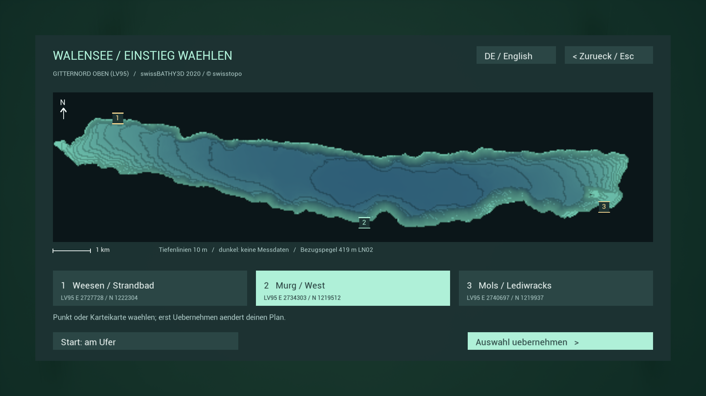
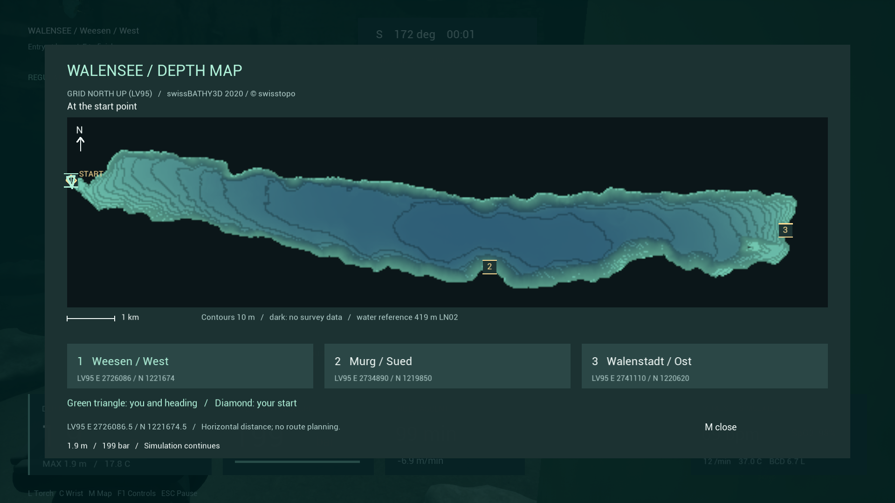

# Map selection and underwater navigation

The entry field now opens the surveyed Walensee overview instead of cycling through names. A player can select a numbered map marker or its matching card, preview shore/offshore starts, and apply the selection to the dive plan. Back or Escape discards the preview. Opening controls also closes the preview. Applying the selection uses the existing settings persistence; the ordinary Start action then places the diver at that entry. There are three shore starts and three offshore starts, with their own names and coordinates.

During a dive, the same page can be inspected from the pause menu but cannot change the entry or start mode. The in-water map action remains available through its configured key (M by default). It shows the actual starting location as an amber diamond, the diver and accepted view direction as a green triangle, the sampled track, and horizontal straight-line distance/bearing to the start. The map does not pause an active dive: depth, gas and a simulation-status label remain visible. In the pause menu the label explicitly says the dive is paused.

The map is north-up in the LV95 grid, with east to the right. World +X corresponds to grid north and +Y to east; yaw increases clockwise from grid north. Bearings share that convention. They are not magnetic-declination-corrected headings. A one-kilometre scale bar uses the same projected survey extent as the map and markers. Positions outside the extent are reported rather than clamped onto its edge.

The overview is a fixed 512×128 sampling of the measured bathymetry over a 16×4 km extent. Ten-metre contour bands use changes in both raster axes. Dark regions indicate missing bathymetry, not guaranteed dry land. The 419 m LN02 water reference and swisstopo attribution are retained. This is an overview rather than a detailed nautical chart: no zoom, route planning, obstacle clearance, live location service or unmeasured shoreline depths are inferred.





## Observer-dependent sky fix

Testing the eastern entry before starting a dive exposed a pre-existing sky-state error. Unreal 5.8.4's Celestial Vault tick recentres its observer-based effects after a movement of more than ten kilometres. That native update writes its mean-period MoonAge even while the sequence clock is paused. Our former time-unchanged early return left that value in place, contradicting the ephemeris phase.

The project now derives a small celestial actor which retains the computed phase and reapplies it after the native tick, including its matching moonlight intensity. Native observer recentering remains enabled. No engine/plugin source or sky asset is modified. The failing paused eastern-entry scenario is part of the navigation matrix; the 18:00 clock-boundary regression also exercises the existing six astronomical reference checks.

## Reproduce

```powershell
./Tools/TestCore.cmd
./Tools/Build.ps1 -Target Editor -EditorSandbox
./Tools/Build.ps1 -Target Package -EditorSandbox -BuildSlot Navigation -PackageDirectory Builds/WindowsNavigation
./Tools/TestNavigation.ps1 -PackageDirectory Builds/WindowsNavigation
# Substitute the actual generated result directory; Python needs Pillow.
python Tools/ReportNavigation.py artifacts/navigation-validation-YYYYMMDD-HHMMSS --output artifacts/navigation-report.json
```

The matrix covers all three entries in both start modes at 1080p, additional 1440p/4K and 1280×1024 views, and shore return, remapped controls, tutorial, 18:00 clock-boundary and sediment regressions. Each navigation case checks thirteen phases: marker and card hit targets, preview cancellation, mode preview, both languages, apply/reload, actual spawn, in-dive map, active-dive protection, controls access and pause invariance. Eight rendered states are preserved for each navigation case. The report rejects missing phases, wrong entry/mode, stale/missing image sets and mismatched viewport dimensions.

Hit targets are resolved through Unreal's [AHUD coordinate hit-box lookup](https://dev.epicgames.com/documentation/unreal-engine/API/Runtime/Engine/AHUD?application_version=5.8), then dispatched through the same HUD click handler. This checks the rendered input regions and their actions; it is not a physical mouse-device test. Native and portable tests independently check coordinate-axis orientation, kilometre scale, bearings, north wraparound and map extent handling.

## Verified package, 25–26 November 2026

`Builds/WindowsNavigation/divingsim.exe` is the ordinary launcher. The named game executable has SHA-256 `489e61140aeba8b309df1b61dd921f86568f0f046c60d0c7e1d80b6b91204ab8`. Editor and Development-package builds succeeded. All 110 source/configuration files match the sandbox used for the build; the 25 avatar assets, underwater/sediment materials and sediment shader retain their previous hashes. The previous WindowsSediment executable is preserved. [Build evidence](NAVIGATION_BUILD.json) includes package archives, source hashes, native automation and test-log references.

All 26 native Unreal tests, 15 Python tests and portable simulation checks passed. The final serial package matrix passed all 14 cases and preserved 107 fresh screenshots, including 72 navigation states. The independent report checked every image's actual resolution, all thirteen phases of each navigation case, requested entry/start mode and log failure markers. Selected 1080p, 4K and 5:4 entry/map states were visually inspected, including the active/paused footer and the absence of overlapping notices. The 18:00 clock test passed its real four-second pause and six astronomical reference checks. Its June images remain in daylight; this is not a new full-night visual acceptance. The sediment comparison also remains visible. [Runtime evidence](NAVIGATION_RESULTS.json) contains per-case logs and image hashes.

These scenario runs use a 30 FPS cap and the user's editor remained open (PID 33256). They establish gameplay/rendering checks, not a new performance benchmark. Earlier performance and two-hour stability reports apply to their recorded package versions.

The ordinary root launcher also started the expected Navigation executable and completed the 22-second dive scenario with exit code zero. [Launcher evidence](NAVIGATION_LAUNCHER.json) records the child executable, matching hash and runtime-log hash.

This increment addresses CONF-001, UI-002 and NAV-001 through NAV-004. Full visual reference acceptance, native macOS gameplay, minimum-hardware validation and the complete requirement set remain open.
