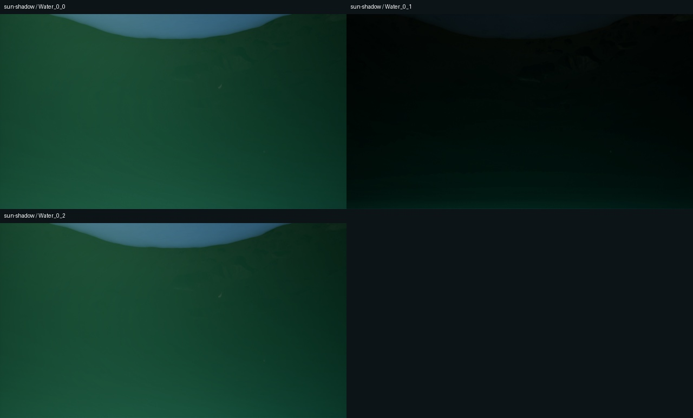
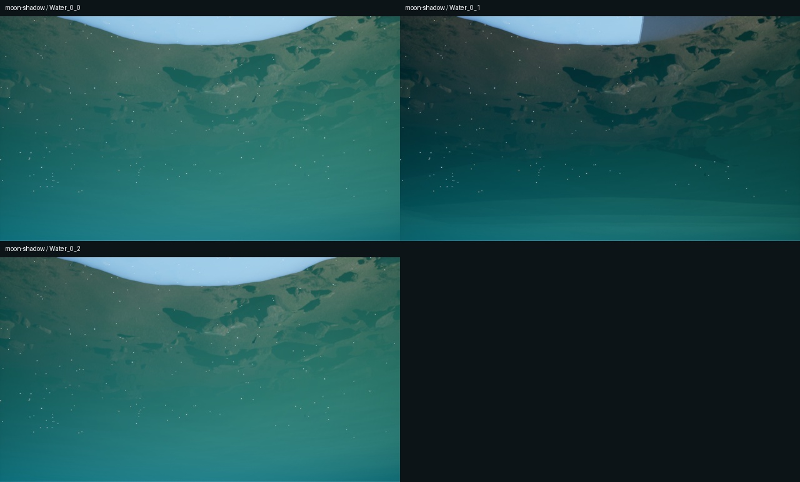

# Abschlussrunde 2: Licht, Sicht und Schatten-Rückfall

Stand: 28. November 2026. **Abschlussrunde 2 bestanden. Der vereinigte VSM-Reflexionsweg ist für die Paketintegration ausgewählt; ein geprüftes Paket liegt damit noch nicht vor.** Die abgenommene Gestaltung wird nicht erweitert. Die acht Grundkontrollen und genau vier zusätzlichen Randfallkontrollen des [Abschlussplans](UNDERWATER_FINISH_PLAN.md) sind abgeschlossen.

## Acht Grundkontrollen

`artifacts/reflection-transport-20261128-010832` enthält alle acht erfolgreichen nativen Aufnahmeläufe mit 24 Bildern. Alle Kontaktansichten wurden betrachtet: Referenz ohne Wasserintegration, klare/trübe Sicht, Nahreferenz und integrierte Nahansicht, Nacht ohne Lampe, Nacht mit Lampe ohne/mit Wasserintegration. Klare Sicht zeigt den Grund weiter als trübe Sicht; gespiegelter Grund und das Blickfenster zur Sonne bleiben erhalten. Die Lampe erzeugt auch im reflektierten Wasser sichtbare Streuung; die Nacht ohne Lampe bleibt dunkel. Die Referenz ohne Integration zeigt weiterhin den bekannten blauen Reflexionsfehler und ist ausdrücklich kein freizugebender Renderpfad.

Die Sichtweitenprüfung enthält keine pauschale Forderung, dass stärkere Extinktion jeden Bildbereich dunkler machen muss: Beleuchtete Streuung kann diese Helligkeitsordnung umkehren. Die vorhandenen Messregionen und Lampenkriterien aus `ReportReflectionTransport.py` werden unverändert weiterverwendet.

## Vier zusätzliche physische Kontrollen

Für jede Kontrolle wird dieselbe Kamera bei einer eingefrorenen Welle etwa 1,5 m unter Wasser verwendet. Die drei Ansichten zeigen **frei → abgeschattet → wieder frei**. Nur ein echter, über Wasser platzierter Schattenwerfer wird sichtbar/unsichtbar geschaltet. Drei Renderprofile liefern den vollständigen Strahlweg als Referenz, den normalen VSM-Kandidaten und eine getrennte farbige Nutzungsdiagnose. Die Farbe der Diagnose ist keine natürliche Beleuchtung.

| Kontrolle | Tatsächliche Szenen-/Ressourcenänderung |
| --- | --- |
| Sonne | Mittagskonstellation mit unveränderter Sonnenintensität; physischer Schattenwerfer |
| Mond | 29. März 2026, 01:59 lokale Zeit, aus den vorhandenen Ephemeris-Referenzen; native Mondrichtung und native phasenabhängige Intensität bleiben unverändert |
| Fehlende Karten | `r.Shadow.Virtual.Enable 0`; tatsächliche Deaktivierung der virtuellen Karten statt eines bloss erzwungenen Shaderzweigs |
| Mehrdeutige Zuordnung | Zweite reale gerichtete Lichtkomponente mit identischer Sonnenrichtung, halber Sonnenintensität und niedrigerer Forward-Priorität; beide Renderprofile enthalten dieselbe zusätzliche Lichtquelle |

Die Fixture existiert ausschliesslich im Smoke-/Bildvergleich. Normale Spielstarts erhalten weder Schattenwerfer noch zusätzliches Licht. Das Protokoll bindet Lichtintensität, Richtung über dem Horizont, Kartenstatus, Duplikatstatus, Kamera und Schattenwerferposition für jede Ansicht. Die drei Positionen müssen übereinstimmen. Der Build `artifacts/reflection-shadow-study/shadow-edge-fixture-build.log` ist erfolgreich.

## Vor der Auswertung festgelegte Grenzen

`ReportReflectionShadowEdges.py` verwendet die gemeinsame Reflexionsmaske der drei Diagnosebilder, mindestens 1000 Pixel. Im normalen und im vollständigen Referenzbild muss die Abschattung die mittlere Anzeigeluminanz um mindestens 0,1 beziehungsweise 2 % des freien Werts vermindern (der grössere Wert gilt). Nach Entfernen des Werfers darf die Abweichung zum ersten freien Bild höchstens zwei Anzeigestufen beziehungsweise 5 % betragen. Der mittlere RGB-Unterschied VSM/Strahlreferenz darf je Ansicht drei Anzeigestufen nicht überschreiten.

Die Sonnenkontrolle muss mindestens 10 % Kartennutzung in der gemeinsamen Maske nachweisen. Bei fehlenden Karten und mehrdeutiger Zuordnung dürfen höchstens 0,5 % als Kartennutzung erscheinen; die kleine Toleranz berücksichtigt die Grenzen der aus Anzeigepixeln rekonstruierten Diagnosemaske. Für den Mond ist ein korrekter Strahl-Rückfall zulässig, falls die aktuell vom Renderer bereitgestellte gerichtete Karte zur Sonne gehört. Eine falsche Zuordnung zur Sonnenkarte wäre kein Erfolg.

Für die zwei Beleuchtungskontrollen wird ausserdem das bereits vorhandene Diagnoseprofil `unshadowed` als gezielte Gegenprobe verwendet. Es deaktiviert nur die Schattenabfrage der reflektierten Wasserintegration; der physische Werfer und der Kameranebel bleiben erhalten. Im abgeschatteten Bild muss der vollständige Reflexionsschatten gegenüber dieser Gegenprobe mindestens 0,1 Anzeigeluminanz bewirken; der VSM-Kandidat muss mindestens die Hälfte dieses Effekts erhalten. Damit genügt eine Abdunklung allein durch den primären Kameranebel nicht als Nachweis. Das Diagnoseprofil wird niemals als Spielmodus freigegeben. Es sind zusätzliche Referenzaufnahmen derselben zwei Kontrollen, keine weitere Gestaltungsrunde.

Diese lokalen Prüfkriterien ersetzen weder die visuelle Auswertung noch sämtliche Entfernungen und Bewegungen. Ein numerischer Fehlschlag bleibt sichtbar; eine zu dunkle Aufnahme ist kein Nachweis funktionierender Mondschatten. Die abschliessende Entscheidung folgt unten mit den tatsächlichen Ergebnissen.

## Testfixture-Korrekturen und Messgrenzen

Der erste Lauf `reflection-transport-20261128-011855` wurde durch die Positionsprüfung verworfen: Beim ersten Teleport lieferte die um die vorherige Spielerposition abgeflachte Wellenhöhe einen Kameraversatz von 0,177 cm. Die Fixture verwendet jetzt unmittelbar die lokale Wellenfunktion; die Positionsprüfung wurde nicht gelockert. Der korrigierte Build `reflection-shadow-study/shadow-edge-clock-build.log` ist erfolgreich.

Die erste vollständige Strahlreferenz `reflection-transport-20261128-012108` erfasst alle vier Kontrollen. Die natürliche Mondaufnahme ist für eine belastbare Schattenmessung im 8-Bit-Bild zu dunkel. Sie wird als natürliche Nachtansicht erhalten, **nicht als bestandener Mondschattennachweis**. Die gezielte Mondkontrolle erhält deshalb ausschliesslich für die Messaufnahme +8 EV Kamerabelichtung, identisch für frei/abgeschattet/wieder frei und beide Renderwege. Lichtquelle, Intensität (etwa 0,082835), Richtung und Transportberechnung bleiben unverändert. Das ist eine Messbelichtung und keine normale Spielansicht; der normale Spielstart und die acht Grundkontrollen behalten ihre ursprüngliche Belichtung.

Der Belichtungsvorversuch `reflection-transport-20261128-012629` macht die Mondabschattung sichtbar, meldet aber eine unpassende FP16-Skalierung des Beleuchtungs-Caches. Er wird nicht als abschliessender Vergleich verwendet. Für die Messbelichtung wird deshalb zusätzlich `r.EyeAdaptation.CachedLightingPreExposure 0` gesetzt: Gemäss der vorhandenen Engine-Implementierung in `PostProcessEyeAdaptation.cpp` umfasst der sichere Bereich damit EV −12 bis +8 und die etwa −9 EV dieser Messkamera. Diese Änderung betrifft nur die interne Speicherskalierung der Mond-Testaufnahme; sie erhöht keine Lichtquelle und unterdrückt keine Warnmeldung.

Die korrigierte Mond-Strahlreferenz liegt unter `reflection-transport-20261128-012803`. Für Sonne und die beiden Ressourcenfälle bleibt die unveränderte Referenz `012108` gültig; die spätere C++-Änderung betrifft ausschliesslich die Messbelichtung des Mondfalls. Der normale VSM-Vergleich `012900` enthält alle vier Fälle mit der endgültigen Messbelichtung.

Die erste Nutzungsdiagnose `013154` ist bei der Mond-Messbelichtung überbelichtet und wird für die abschliessende Maske ersetzt. Das Diagnoseprofil gibt seine Rot-/Grünwerte jetzt direkt als vorbelichtetes Anzeigesignal aus. Nur in diesem Diagnoseprofil ist zusätzlich die Überlagerung des primären Kameranebels ausgeschaltet (`ShowFlag.Fog 0`), damit sie den Farbcode nicht verfälscht. Das Wassermedium und die reflektierte Schattenabfrage bleiben aktiv. Die normalen Renderprofile werden dadurch nicht verändert. Die Grenzwerte der Schattenwirkung und des Referenzvergleichs bleiben unverändert.

## Abschlussbefund und Entscheidung

Die endgültige Nutzungsdiagnose `reflection-transport-20261128-013518` zeigt Sonnenkartennutzung in der gemeinsamen Reflexionsmaske und den Strahl-Rückfall für Mond, fehlende Karten und mehrdeutige Lichtzuordnung. Alle zwölf Diagnosebilder und alle normalen Vergleichskontakte wurden gesichtet. Die kausalen Gegenproben ohne reflektierte Schattenabfrage liegen unter `013929` (Sonne) und `014046` (Mond); die Kamera, Lichtquelle, Werferposition und Messbelichtung stimmen mit den Referenzen überein. Nach Entfernen des Werfers kehrt die freie Ansicht zurück. Kein Abschlusslauf meldet Shaderfehler oder Ersatzmaterialien.

| Fall | VSM-Abdunklung, Anzeigeluminanz | Grösste mittlere RGB-Abweichung zur Strahlreferenz | Kartennutzung | Ergebnis |
| --- | ---: | ---: | ---: | --- |
| Sonne | 46,31 | 0,23 / 255 | 100 % | Bestanden |
| Mond, +8 EV Messbelichtung | 34,61 | 0,43 / 255 | 0 %; Strahl-Rückfall | Bestanden |
| Karten deaktiviert | 46,35 | 0,26 / 255 | 0 %; Strahl-Rückfall | Bestanden |
| Zweite gerichtete Lichtquelle | 46,39 | 0,26 / 255 | 0 %; Strahl-Rückfall | Bestanden |

Die isolierte Wirkung der reflektierten Schattenabfrage beträgt für Sonne 7,96 gegenüber 7,97 Anzeigestufen der vollständigen Referenz, für Mond 26,36 gegenüber 26,42. Damit ist die Wirkung nicht allein durch den Nebel des primären Kamerablicks erklärt. Die Nachtkontrolle ohne Lampe hat in der festgelegten Region Luminanz 0; die reflektierte Lampenstreuung erhöht sie gegenüber der ausgeschalteten Integration um 7,53. Alle vorab festgelegten Zahlenkriterien sind erfüllt. Der [vollständige Prüfnachweis](REFLECTION_FINISH_RESULTS.json) enthält Werte, Einstellungen, Eingabemanifeste und Bildprüfsummen.





**Auswahl für Runde 3:** `unified` mit Profil `vsm`, ursprüngliche physische Lichtintensitäten und normale Spielbelichtung. Der vollständige Strahlweg bleibt als automatische Rückfallebene erhalten. Die Diagnoseprofile, der Werfer, das zusätzliche Licht, +8 EV und die abweichende Cache-Skalierung werden nicht Bestandteil normaler Spielstarts. Die Shader-Vorbereitung wurde nach den Kontrollen wieder auf `vsm` zurückgesetzt. Die produktive Lichtberechnung wurde in dieser Runde nicht umgestaltet; geändert wurden die reproduzierbare Testfixture und die zuvor überbelichtete Farbdarstellung der Nutzungsdiagnose.

Die Grenzen UW-LATER-01 bis -03 und der in Runde 1 dokumentierte Wasserlinienrestpunkt bleiben erhalten. Die untersuchten festen Szenen sind kein Nachweis für jede Entfernung und Bewegung. Paketierung, normale Starts, Geschwindigkeit und Dauerstabilität folgen wie vereinbart in Runden 3 bis 5.

Auswertung reproduzieren:

```powershell
Tools/.geodata-env/Scripts/python.exe Tools/ReportReflectionShadowEdges.py artifacts/reflection-shadow-edges-20261128-012108 --response artifacts/reflection-transport-20261128-010832 --reference-moon artifacts/reflection-transport-20261128-012803 --coverage artifacts/reflection-transport-20261128-013518 --unshadowed-sun artifacts/reflection-transport-20261128-013929 --unshadowed-moon artifacts/reflection-transport-20261128-014046
```

Neue Bildreihen lassen sich mit `TestReflectionShadowEdges.ps1` und den zwei `TestReflectionTransport.ps1 -Unified -Profile unshadowed -Suite shadows -CaseName sun-shadow` beziehungsweise `moon-shadow` erzeugen. Die zugehörigen neuen Verzeichnisse sind der Auswertung ausdrücklich zu übergeben; historische Referenzen werden nicht überschrieben.
