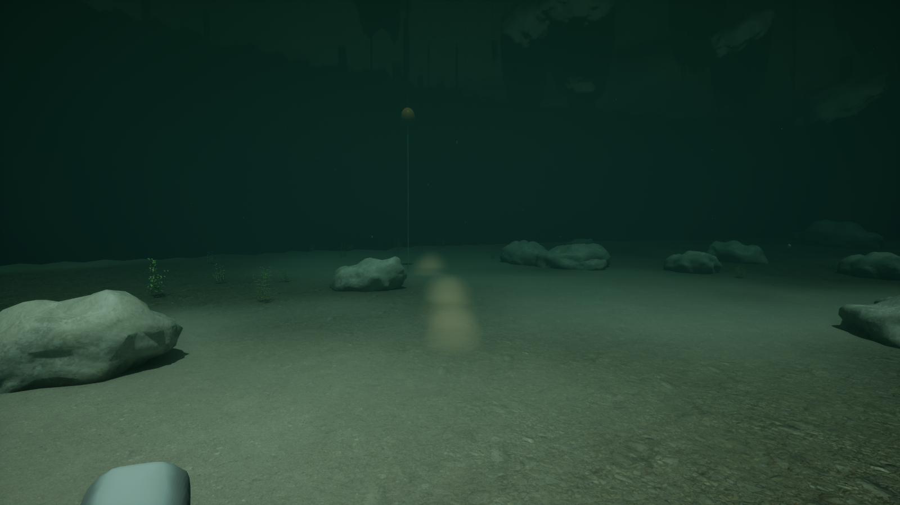
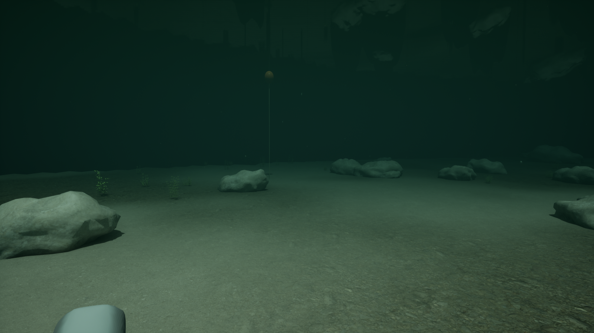

# Fin-stirred sediment

WATR-011 now has a playable implementation: accepted fin strokes near the lake bed release local sediment clouds. Stronger strokes and smaller bed clearance increase emission. A still fin, a fin in air, a fin more than 80 cm above the bed, and a fin above a rock or access platform do not emit. Collision-blocked joint movement does not stir the bed. Terrain and shore meshes are treated as soft bed; this classification is authored, not a surveyed sediment map.

Each cloud expands, moves with the configured current and local wave velocity, loses density and settles. Simulation uses the existing 50 Hz step and stops with the pause menu. At most 24 clouds are alive, each for at most 45 seconds; new emissions are dropped at saturation. Clouds farther than 40 m from the diver, outside loaded terrain or crossing the water surface are removed. The final eight seconds fade to zero before removal. Density is a visual game model, not a calibrated sediment concentration or a prediction of local transport.

The GPU integrates eight samples of irregular radial density through each translucent sphere and clips the integral at opaque scene depth. It handles views from outside and inside a cloud. Direct lighting uses Unreal's volumetric translucency lighting; an authored ambient scattering term follows the existing day/night and depth illumination proxy. This term is supplied through the material's emissive input but does not illuminate the scene. It approximates scattered ambient light; it is not a complete participating-media or multiple-scattering solution. The opaque-distance underwater attenuation runs before depth of field; the sediment is composed afterward. Otherwise the distance to a remote background would incorrectly erase a nearby cloud, including when the eye is inside it. Overlapping translucent volumes retain ordinary engine sorting limitations.

The clouds use pooled components with no collision, shadow casting or ray-tracing participation. The CPU updates positions and material parameters; this is not a Niagara or GPU fluid simulation. The existing GPU suspended particles and regulator bubbles remain separate effects.

## Reproduce

```powershell
./Tools/Build.ps1 -Target Editor -EditorSandbox
./Tools/Build.ps1 -Target Content -EditorSandbox -OnlySediment
./Tools/Build.ps1 -Target Package -EditorSandbox -BuildSlot Sediment -PackageDirectory Builds/WindowsSediment
./Tools/TestSediment.ps1 -PackageDirectory Builds/WindowsSediment
# Replace the example with the actual result directory; Python needs numpy and Pillow.
python Tools/ReportSediment.py artifacts/sediment-validation-YYYYMMDD-HHMMSS --output artifacts/sediment-report.json
./Tools/Benchmark.ps1 -PackageDirectory Builds/WindowsSediment -Scenario sediment -Resolution 1080p -Quality 2 -RenderScale 100 -Seconds 60
```

The sediment fixture starts above the actual bed, swims using ordinary inputs and collision-accepted joint poses, then stops kicking and observes the clouds. It checks emission, bounded state, pause invariance and eventual clearing. Paused visible/hidden screenshots compare the same scene with just the sediment toggled. Temporal shading can still change some pixels; the standard Weesen comparison has a visibility regression gate, while sloped terrain can occlude clouds at the other entries. Image differences are not photorealistic acceptance.

Portable tests cover the emission thresholds, strength and clearance dependence, finite inputs, time-step invariance, dilution, settling and bounded lifetime. The nine packaged scenarios cover daytime sediment at all three entries, night sediment at Weesen, all three shore returns, breathing-source changes and terrain streaming. Benchmark CSVs record the live cloud count for each measured frame, so a run with no active sediment cannot be presented as an active-cloud measurement.

Normal Weesen comparison from the packaged game, with the simulation paused. The first image includes the fin-stirred clouds; the second hides only those clouds. These are unedited captures. The two close brown lobes remain a simplified visual representation.





The separate composition diagnostic uses `-DiveSmokeTest -DiveScenario=sediment -DiveEntry=0 -DiveNoBubbles -DiveSedimentProbe` and a 1600×900 viewport. Adding `-DiveSedimentProbeInside` places the camera at its centre. The diagnostic deliberately uses a large magenta volume and exits after the paused comparison; it does not report a normal gameplay pass. Preserve each run's `Runtime.log` and `Sediment_0_Visible.png` / `Sediment_0_Hidden.png` in separate directories, then run `Tools/ReportSedimentProbes.py OUTSIDE_DIRECTORY INSIDE_DIRECTORY --output REPORT.json`. Its distant-background band must remain visibly covered in both views. These flags require smoke-test mode and do not alter normal play.

## Limits

There is no measured grain-size distribution, erosion/deposition map, mass exchange with the bed, flow around obstacles, turbulence solver or sediment interaction with fish and equipment. The 80 cm reach, optical density, settling response and pool limit are authored compromises. Visual reference acceptance, minimum-hardware performance, native macOS gameplay and the full 236-requirement acceptance remain open.

## Verified Windows package

The final WindowsSediment package passed all 9 gameplay cases, producing 61 fresh screenshots. Sediment lifecycle and pause checks passed at all three entries and at night; all three shore returns, breathing and streaming also passed. The standard Weesen comparison changed 13,757 pixels by more than five channel levels in its 400×400 comparison area. This supports visibility, not visual reference acceptance. [Gameplay evidence](SEDIMENT_RESULTS.json).

The outside/inside diagnostic covers the formerly erased background band in both views: [composition evidence](SEDIMENT_PROBES.json). Twenty-five native Unreal tests, fifteen Python tests and the portable simulation checks passed. All 104 source/configuration files match the build sandbox, and the 25 avatar assets and prior Contacts executable are unchanged. [Build evidence](SEDIMENT_BUILD.json) includes executable, package archive, material and source hashes. The ordinary package launcher also passed its gameplay check: [launcher evidence](SEDIMENT_LAUNCHER.json).

A 60-second sediment capture after 15 seconds of warmup measured **87.34 mean FPS / 67.03 one-percent-low FPS**, with 5,238 of 5,238 frames containing live clouds (range 6–24, mean 19.51). A separate ordinary underwater capture measured **86.45 / 69.90 FPS**. Both used 1920×1080, quality 2 and 100% render scale on RTX 3090 / Ryzen 9 9950X3D. A user-owned Unreal Editor was open during capture; these are measurements under concurrent load, not isolated comparisons. Live counts describe simulated clouds, not guaranteed on-screen coverage or worst-case translucent overdraw. The ordinary underwater run also stirred up to two clouds. The two scenarios use different routes and do not isolate the cost of sediment. [Sediment performance](SEDIMENT_PERFORMANCE.json), [underwater performance](SEDIMENT_UNDERWATER_PERFORMANCE.json).
