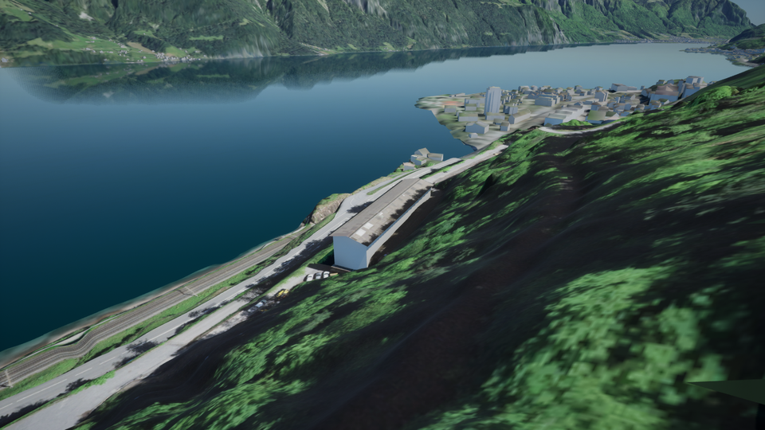
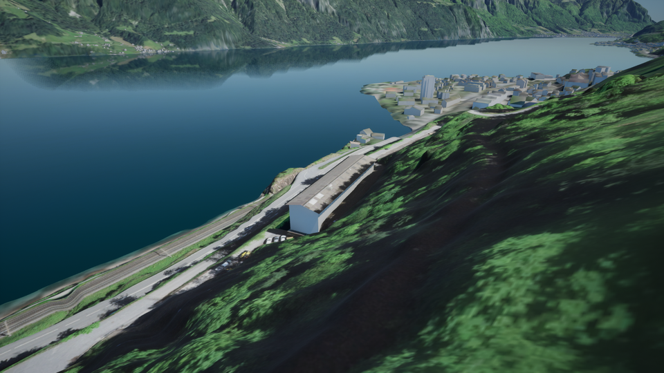

# Anschluss der Ufer an die Hintergrundlandschaft

Die feinen Ufermeshes schließen jetzt an denselben Rand wie das 8-m-Hintergrundgelände an. Die bisherige Überlappung konnte zwei unterschiedliche Höhen an derselben Stelle darstellen: Am alten Rand betrug die maximale Abweichung 15,39 m bei Weesen, 4,60 m bei Murg und 4,45 m bei Mols/Lediwracks. Daraus entstanden abstehende Dreiecke, rechteckige Materialwechsel und stellenweise offene Ansichten zwischen den Flächen.

## Geometrie und Darstellung

Die äußeren Grenzen werden auf das Vertexraster der Hintergrundlandschaft erweitert. Bei den vorhandenen Daten wächst die Darstellung von 382 × 382 m auf 392 × 392 m; das ursprüngliche Quellenraster bleibt 384 × 384 m groß. Das neue Randraster liegt vier Meter außerhalb der Quellenausdehnung und stimmt mit den Hintergrundvertices im Abstand von acht Metern überein. Hintergrunddreiecke innerhalb dieses Rechtecks werden entfernt. Der bisherige acht Meter breite Überlappungsbereich entfällt.

Innerhalb eines 32 m breiten Randbands gehen die feinen Höhen mit einer glatten Gewichtsfunktion in die tatsächlichen Dreiecksflächen des gröberen Geländes über. Eine bilineare Interpolation würde bei nicht ebenen Rasterzellen die gerenderte Fläche verfehlen; deshalb verwendet `SurfaceGrid::SampleTriangle` dieselbe Diagonale wie das Hintergrundmesh. Zwischen den gemeinsamen 8-m-Randvertices liegen die 1-m-Ufervertices exakt auf deren Kanten. Die neuen äußeren vier Meter verwenden eine begrenzte Fortsetzung der feinen Randwerte und laufen zur Hintergrundfläche aus.

Das ist eine abgeleitete Annäherung für Darstellung und Kollision, keine neue Vermessung. Die Quellen werden nicht verändert. Außerhalb des Übergangsbands behalten die Ufervertices die ursprünglichen interpolierten Höhen. Vermessene Bathymetrie hat überall Vorrang, auch im Band. Vollständig vermessene Seebodendreiecke bleiben im bisherigen Streaming. Die Bodenabfrage verwendet dieselben erzeugten Vertexhöhen und dieselben Dreiecksflächen wie die begehbaren Ufermeshes.

Beleuchtungsnormalen und Luftbilder gehen ebenfalls zur Hintergrunddarstellung über. Der Rand verwendet das globale, geografisch registrierte SWISSIMAGE-Bild; das feinere örtliche Bild erhält nach innen zunehmend Gewicht. Sand-, Kies- und Felsmaterial unter Wasser bleiben vorhanden. Gebäude behalten ihre vermessenen Positionen; an grob angenähertem Gelände können Sockelabweichungen weiterhin auftreten.

Die äußeren Randwerte stammen weiterhin aus dem groben Höhenmodell. Auch der neue Übergang rekonstruiert keine unbekannten Felswände, Straßenbefestigungen oder Zugangsanlagen. Ferne Landflächen haben weiterhin keine Spielerkollision. Über den ganzen See verteilt sichtbare Wasserlinien-/Bathymetrieübergänge, flache fotografierte Vegetation und gestreckte Luftbilder an steilen Flächen bleiben gesonderte Arbeiten.

## Prüfungen

Vergleich bei Murg mit identischer erhöhter Prüfkamera, normalen Schatten und unveränderten Quelldaten; beide Aufnahmen stammen aus verpackten Windows-Builds und sind nur verkleinert:

| Vorher | Neuer Anschluss |
|---|---|
|  |  |

Bei Weesen bleiben großflächige harte Schatten auf den groben Steilflächen sichtbar. Drei zusätzliche Diagnoseläufe unterscheiden diese von offenen Geometriegrenzen: Das Abschalten der Schatten entfernt die dunklen Formen, das separate Abschalten von Distance-Field-Schatten beziehungsweise AO nicht. Die normalen Spieleinstellungen behalten die dynamischen Schatten. Diese Diagnose ist keine Abnahme der Beleuchtungsqualität; vor allem steile Felsen, Schatten und im Luftbild vorhandene Beleuchtung benötigen weitere Arbeit.

Die engineunabhängigen Tests prüfen die Ausdehnung des Rands, alle Punkte eines synthetischen Perimeters, den Unterschied zwischen Dreiecks- und bilinearer Interpolation, Randzellen, unveränderte innere Werte und die Begrenzung der Übergangshöhen. Die vorhandene unabhängige Quellenprüfung vergleicht die Uferdaten weiterhin mit den nativen swisstopo-Rastern und bestätigt die unveränderten 10.700 modellierten Lückenzellen.

Die Laufzeitprüfung liest die tatsächlichen Procedural-Mesh-Vertices zurück. Sie vergleicht oberirdische Randpunkte mit dem Hintergrundraster und sämtliche inneren Land- sowie verfügbaren Bathymetrievertices mit den Originaldaten. Die Randprüfung vergleicht Quellgeometrie; sie ist kein mathematischer Nachweis aller möglichen Nanite-LOD-Zustände. Gerenderte Ansichten mit und ohne Nanite ergänzen sie.

Der verpackte Stand `Builds/WindowsShoreSeams/divingsim.exe` besteht alle zwölf Paketläufe mit 61 frischen Bildern, alle 30 nativen Unreal-Tests, die Kernprüfungen und 21 Python-Tests. Die unabhängige Auswertung bestätigt 53 unveränderte Vermessungsraster und identische Vergleichskameras. An den 2.317 geprüften oberirdischen Randvertices beträgt die größte numerische Abweichung von der Hintergrundfläche 0,000977 cm. Das beschreibt die Übereinstimmung der erzeugten Geometrie, nicht die Genauigkeit der realen Vermessung. Der vorherige Buildings-Build ist unverändert erhalten. Maschinenlesbare Nachweise: [SHORE_TRANSITION_RESULTS.json](SHORE_TRANSITION_RESULTS.json).

Zwei Messungen über jeweils 60 Sekunden bei 1920 × 1080, Qualität 2 und 100 % Renderauflösung ergeben:

| Strecke | Mittel | Langsamstes Prozent | Längstes Bild | Bilder |
|---|---:|---:|---:|---:|
| Ufer Murg | 96,90 FPS | 79,27 FPS | 13,25 ms | 5.812 |
| Sediment Weesen | 91,43 FPS | 74,79 FPS | 14,48 ms | 5.484 |

Kein gemessenes Bild überschreitet 16,67 ms. Der Benutzereditor blieb geöffnet; während der Messungen lief keine weitere Spielinstanz. Hardware: RTX 3090 / Ryzen 9950X3D. Diese kurzen Strecken belegen weder Mindesthardware noch Langzeitstabilität oder den aufwendigsten sichtbaren Szenenausschnitt. Es handelt sich nicht um eine isolierte Vorher-Nachher-Leistungsmessung. Nachweis: [SHORE_TRANSITION_PERFORMANCE.json](SHORE_TRANSITION_PERFORMANCE.json).

Der normale Starter `Builds/WindowsShoreSeams/divingsim.exe` startet die erwartete Paketdatei, besteht den automatisierten Tauchgang und beendet sich mit Exitcode 0. Prozessabstammung und Datei-Hashes sind in [SHORE_TRANSITION_LAUNCHER.json](SHORE_TRANSITION_LAUNCHER.json) festgehalten.

Reproduktion:

```powershell
./Tools/TestCore.cmd
python Tools/validate_shoreline.py
./Tools/Build.ps1 -Target Editor -EditorSandbox
./Tools/Build.ps1 -Target Landscape -EditorSandbox
./Tools/Build.ps1 -Target Content -OnlyShore -EditorSandbox
./Tools/Build.ps1 -Target Package -EditorSandbox -BuildSlot ShoreSeams -PackageDirectory Builds/WindowsShoreSeams
./Tools/TestBuildings.ps1 -PackageDirectory Builds/WindowsShoreSeams -ShoreSeams
```

Die zwölf Paketläufe prüfen drei feste Vergleichskameras, einen Fallback ohne Nanite, die drei Uferwege, Sediment/Kopfdrehung, Avatar, Atmung, Computer und Populations-Streaming. `ReportShoreTransition.py` erhält das ausgegebene Ergebnisverzeichnis als Argument und benötigt NumPy und Pillow. Es vergleicht zusätzlich die vollständigen Quellraster mit dem Git-LFS-Stand vor dieser Änderung und die Kamerapositionen mit den vorherigen Prüfaufnahmen. Die 30 nativen Unreal-Tests werden separat im frisch gebauten Sandbox-Editor ausgeführt.
