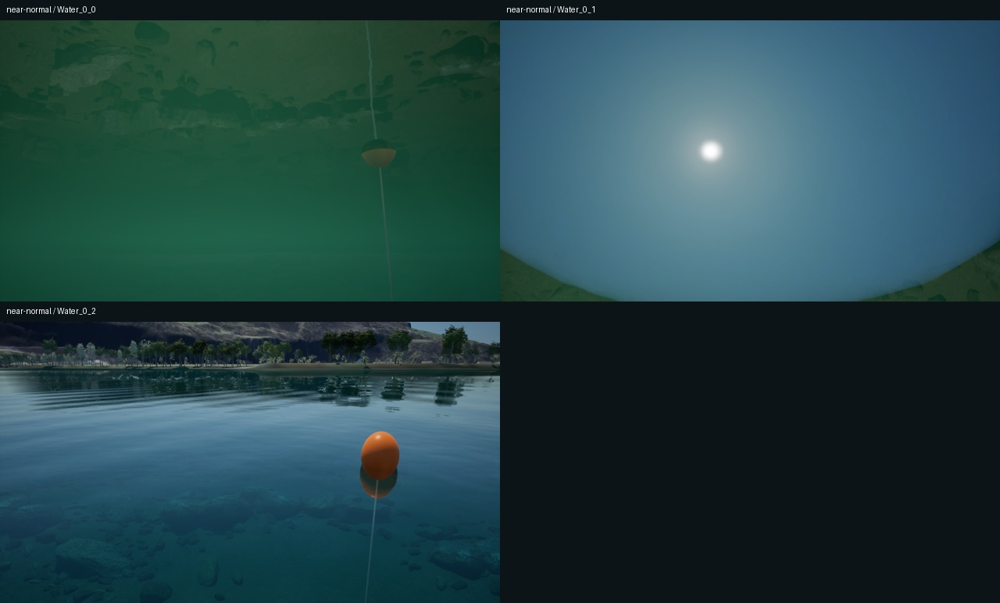

# Abschlussrunde 3: normal startbares Wasserpaket

Stand: 28. November 2026. **In Bearbeitung. Korrigiertes Paket R2 erstellt; der gezielte Kameratest besteht ohne den vorherigen Himmel-Materialfehler. Die vollständige Paketserie läuft, die normale Menübedienung ist noch offen. Noch keine vollständige Paketabnahme.** Die [zweite Abschlussrunde](REFLECTION_FINISH_VALIDATION.md) hat den vereinigten VSM-Reflexionsweg für diese Integration ausgewählt.

## Buildverlauf und eingefrorene Eingaben

Der erste monolithische Source-Game-Build verwendete die getrennte Sandbox `Builds/SourceEditorSandbox/divingsim` mit Quellstand `edf27cd728b02eae05020e46536f19980d6d2dea`, vor der normalen Laufzeitintegration. Das Protokoll liegt unter `artifacts/underwater-package-20261128/source-game-build.log`; `FoundationInputs.json` bindet die damaligen Source-, Config- und Shaderdateien. Von 1’117 eingeplanten Aktionen waren 234 abgeschlossen, als der Build bewusst für die vorgezogene Integrationsprüfung unterbrochen wurde. Seine letzten Prozesse wurden anhand der tatsächlichen UnrealBuildTool-Kommandozeile identifiziert und beendet. Der resultierende Exitcode 1 ist kein erfolgreicher Abschluss und kein nachgewiesener Compilerfehler.

Der Grund für die Unterbrechung: Die parallele Integrationsvorbereitung war fertig; ein kurzer Editor-Nachbau konnte deren native Funktion vor dem restlichen langen Game-Build prüfen. Die bereits erzeugten Engine-Objekte bleiben erhalten. Erst nach dem bestätigten Prozessende wurde die Sandbox auf `0751e593504fc43bb0a4a1e7274d100dffeff07a` synchronisiert. Der Editor-Nachbau unter `production-editor-build.log` bestand nach elf Aktionen und 58,99 Sekunden. Zwei bereits vorhandene `double`-zu-`float`-Warnungen in der Kaustikprüfung verhindern den Build nicht. Nach erfolgreichem Renderlauf wurde der Game-Build unter `production-game-build.log` inkrementell fortgesetzt. **Eine laufende Sandbox weiterhin nicht synchronisieren.**

Bis zu vier Aktionen dürfen parallel laufen; tatsächlich begrenzen auch Abhängigkeiten und die Speicherprognose die Ausführung. Eine wegen Speicherdruck angehaltene `PCH.Engine.cpp`-Aktion wurde im Foundation-Lauf erfolgreich wiederholt. Verwaiste MSBuild-Hilfsprozesse des abgeschlossenen Build-Tool-Setups wurden nach Prüfung ihrer Herkunft und des fehlenden Elternprozesses geschlossen. Die Speicher-Schutzgrenzen wurden nicht gelockert.

## Vorbereitete Integration

Der fortgesetzte Game-Build ist mit Exitcode 0 und `Result: Succeeded` abgeschlossen: 882 Aktionen, 4’157,70 Sekunden, einschliesslich Verlinkung und Zielmetadaten. Die erzeugte `divingsim.exe` ist 335’105’536 Bytes gross. Der [Buildnachweis](PRODUCTION_GAME_BUILD_EVIDENCE.json) bindet EXE, Zielmetadaten, vollständiges Buildprotokoll und alle 174 Projektquellen, Konfigurations- und Shaderdateien. Diese Eingaben stimmen nach dem Build weiterhin mit dem nativ geprüften Integrationsstand `0751e593504fc43bb0a4a1e7274d100dffeff07a` und dem Hauptprojekt überein. Spätere Werkzeug-/Dokumentationsänderungen werden im Nachweis getrennt ausgewiesen.

Anschliessend wurde `Build.ps1 -Target Package` für `Builds/WindowsUnderwaterFinalCandidate` gestartet. `production-package-build.log` erfasst den ersten Paketaufruf. Ein erfolgreicher Game-Build ist noch kein Cook- oder Paketnachweis; der Kandidat bleibt bis zu den unten genannten Prüfungen offen.

Der erste Paketaufruf bestand alle drei Asset-Vorprüfungen: Ufer 644 Kacheln/496 Assets, Gebäude 16’249 Gebäude/715 Kacheln und Gelände 77 Kacheln. Er brach danach beim Kompilieren des AutomationTool-iOS-Moduls mit `MSB3554` ab; der Cook hatte noch nicht begonnen. Ursache waren beim ursprünglichen Engine-Setup ausgeschlossene iOS-Ressourcen. Drei Originalabhängigkeiten wurden gemäss [Einrichtungsnachweis](SOURCE_AUTOMATION_DEPENDENCIES.json) ergänzt. Der zweite Paketaufruf schreibt in `production-package-build-r02.log`; das erste Fehlerprotokoll bleibt erhalten. Für diesen Aufruf verhindert `MSBUILDDISABLENODEREUSE=1` nur im gestarteten Prozessbaum zurückbleibende MSBuild-Hilfsprozesse. Projekt-, Renderer- und Shaderquellen bleiben unverändert.

Der zweite Aufruf hat die AutomationTool-Initialisierung erfolgreich passiert, `UnrealPak` (348 Aktionen) und den Bootstrap-Launcher gebaut sowie Cook, Staging und Archivierung abgeschlossen: `BUILD SUCCESSFUL`, Exitcode 0, insgesamt 26 Minuten 3 Sekunden AutomationTool-Laufzeit. Die Speicherbereinigung während des Cooks hat Fortschritt zugelassen; dieser erfolgreiche Vorgang ersetzt keinen späteren Spiel-Dauerlauf. Der [erste Paketnachweis](PRODUCTION_PACKAGE_FIRST_EVIDENCE.json) bindet 53 Laufzeitdateien einschliesslich EXE, Launcher und aller Pak-/IoStore-Container. Die Spiel-EXE stimmt mit dem zuvor abgeschlossenen Game-Build überein.

## Erster normaler Paketstart und gezielte Korrektur

`Start-DiveSimulator.cmd` wurde ohne zusätzliche Argumente gestartet. Das Hauptmenü wurde angezeigt. Das Laufzeitprotokoll bestätigt eine leere Spielkommandozeile, `cooked=1`, `profile=vsm diagnostic=0`, `unified=1`, `smoke=0`, die Wasserszene und das Seegrenzenraster. Die eigentliche Maus-/Menüprüfung ist noch offen: Eine Windows-Sicherheitsabfrage für `.NET Host` verdeckt die Oberfläche und muss vom Nutzer selbst geschlossen werden; es wurde keine Netzwerkfreigabe erteilt.

Der erste Start meldet zudem einen echten Inhaltsfehler: Der `CelestialVaultDaySequenceActor` sucht sein voreingestelltes Sternenmaterial unter einem alten Objektnamen. Eine native Editor-Inspektion weist die alte Datei als `ObjectRedirector` und das Ziel als `/CelestialVault/Materials/MI_Stars_EnergyConservative.MI_Stars_EnergyConservative` nach. Das Ziel ist gekocht, der alte Editor-Redirector nicht. Das Spiel setzt zwar dieses kanonische Material später selbst, der Konstruktorfehler wird dennoch nicht als erfolgreiche Paketabnahme gewertet.

`Tools/PrepareCelestialPackagePatch.py` bereitet für den geprüften 5.8.4-Quellstand die Korrektur genau dieses hart codierten Verweises vor. Die kleine Änderung wurde ausschliesslich in der separaten Source-Engine angewendet. Das Material und die gewünschte Darstellung werden dadurch nicht ersetzt. `SmokeTest.ps1` weist nun auch fehlende Konstruktor-Assets zurück: Ein echter Lauf des ersten Pakets meldet zwar `DIVE_SMOKE_PASS rocks=1`, endet wegen des fehlenden Materials aber korrekt mit Werkzeug-Exitcode 1. Der [Korrekturbericht](CELESTIAL_PACKAGE_FIX.json) hält diese Gegenprobe und die Inspektion fest. Alle drei Bilder des ersten Pakets wurden gesichtet: grüne Unterwasserreflexion mit gespiegeltem Grund, Sonnenblick durch das Brechungsfenster und Überwasseransicht mit Boje und sichtbarem Grund. Diese Tagesbilder heben den protokollierten Materialfehler und die ausstehende Nachtprüfung nicht auf.

Der gezielte Editor-Nachbau unter `celestial-editor-build.log` bestand mit Exitcode 0 nach 21,84 Sekunden. Das korrigierte Paket `Builds/WindowsUnderwaterFinalCandidateR2` ist ebenfalls erstellt (`production-package-build-r03.log`, Exitcode 0, 3 Minuten 28 Sekunden AutomationTool-Laufzeit). Ein vorübergehender Fehler beim Lesen des lokalen Zen-Speichers wurde durch den eingebauten Wiederholungsversuch überwunden; Cook, Staging und Archivierung endeten erfolgreich. Der [R2-Paketnachweis](PRODUCTION_PACKAGE_R2_EVIDENCE.json) bindet erneut 53 Laufzeitdateien und den korrigierten Engine-Quelltext.

Derselbe Kameratest besteht im korrigierten Paket mit Werkzeug-Exitcode 0, `cooked=1` und ohne den fehlenden Konstruktor-Verweis. Die achtzehnteilige Paketserie gegen R2 liefert nach einer gezielten Wiederholung des Handgelenkfalls alle 84 vorgesehenen Bilder. Der erste Versuch erwartete fälschlich zwei statt der vier ausdrücklich erzeugten Handgelenkbilder; die ursprüngliche Zurückweisung bleibt unter `wrist-count-before/RejectedCapture.json` erhalten. Alle Bilder und 15 ausgewählte Editor-/Paketpaare wurden gesichtet. Der [R2-Prüfbericht](PRODUCTION_PACKAGE_R2_REVIEW.json) bindet beide Läufe, alle Originalbilder und Laufzeitprotokolle. Alle 53 Paketdateien wurden danach erneut gegen den unveränderten R2-Nachweis geprüft.

**R2 ist trotzdem nicht freigegeben:** Der direkte Bildvergleich weist deutlich zu schwache Sonnenabschattung nach. `CAPTURE_PASS` besagt nur, dass der native Ablauf und seine Aufnahmen vollständig sind. Eine erste positive Einschätzung der Abschattung anhand der Einzelbilder war unzutreffend und wurde beim direkten Vergleich korrigiert. Die Mondkontrolle reagiert; ihre +8-EV-Messbelichtung ist ausdrücklich keine normale Nachthelligkeit. Die Uferabläufe, drei Wasserstarts, klare/trübe Sicht, Lampe, Menü/HUD und vier Handgelenkbilder sind vorhanden. Der Softwarepfad startet, zeigt aber blaue Unterwasserbänder und deutlich schwächere Unterseitenreflexionen (UW-LATER-08). UW-LATER-07 bleibt unverändert offen. Die echte Menübedienung wartet weiterhin auf das manuelle Schliessen der Windows-Sicherheitsabfrage.

## Gezielte Schatten-Cache-Korrektur für R3

Der aktuelle Source-Editor reproduziert mit normaler Produktionskonfiguration weiterhin die erwartete Sonnenabschattung. Das Abschalten der Strahl-Ausblendung im Paket und eine Kontrolle mit derselben Qualitätsstufe 2 beheben den Unterschied nicht. Inline-Tracing ist bereits korrekt auf 0 gesetzt; beide Richtungslichter haben Schatten und volumetrische Schatten aktiviert.

Die entscheidende Kontrolle setzt `r.Shadow.Virtual.MarkCoarsePagesDirectional=1`. Der lokale UE-5.8.4-Quelltext in `VirtualShadowMapClipmap.cpp` beschreibt den Standardwert 2 als Modus, der Änderungen der Geometrie für grobe Schattenseiten nicht invalidiert. Mit Wert 1 werden diese Seiten regulär aktualisiert. Die Kontrolle stellt die Abschattung im Paket wieder her: Der Helligkeitsabfall über das gesamte Bild beträgt 48,28 von 255 Stufen gegenüber 48,26 im Editor; R2 ohne Korrektur liefert nur 4,61. Das ist eine Vergleichsmessung des gesamten Bildes, keine isolierte Reflexionsmessung und kein Leistungsnachweis. Alle drei Kontrollbilder wurden neben den Editorbildern gesichtet; Abschattung und anschliessende Wiederherstellung stimmen sichtbar überein. Originaldaten im [Diagnosebericht](PRODUCTION_SHADOW_CACHE_DIAGNOSIS.json).

`DiveRendering` setzt diese Einstellung jetzt ausschliesslich für den normalen Produktions-Wasserpfad und protokolliert den tatsächlichen Wert. Smoke-, Leistungs- und Dauerlaufwerkzeuge verlangen diesen Marker. Der Editor-Nachbau besteht nach 18,19 Sekunden. Ein separater Kandidat `Builds/WindowsUnderwaterFinalCandidateR3` wird gebaut; erst seine nativen Bilder ohne zusätzlichen Konsolen-Override können die integrierte Korrektur bestätigen. R2 und der erste Kandidat bleiben unverändert als historische Gegenproben erhalten.

- `[DiveRendering] ProductionWater=True` wählt auf der separat gepatchten Source-Engine den geprüften Renderweg für normale Starts. Die drei Binding-Versionen müssen vorhanden sein. Die unveränderte installierte Engine erhält dadurch keine inkompatible Szenenstruktur.
- Wasseroberfläche, begrenztes Volumen, Seegrenzenraster und Reflexionsmaske werden ohne Smoke-/Study-Schalter aktiviert. Das Profil bleibt `unified/vsm` mit ursprünglicher Spielbelichtung und ursprünglichen Lichtintensitäten. Die anderen Lichtmodell-Experimente werden nicht freigegeben.
- Der Editor und Cooker verwenden die separat vorbereiteten Shader unter `Intermediate/DiveReflectionProduction`. Ein gekochtes Spiel lädt seine enthaltenen Shader und benötigt keine lokalen Engine-Quelldateien oder `Intermediate`-Dateien. Shader-Experimente werden im neuen gekochten Spiel zurückgewiesen; ein Diagnoseprofil darf keinen normalen Start beeinflussen.
- Die Szenenstruktur bleibt beim Abschalten von Hardware-Raytracing bestehen. Der vorhandene Software-Ersatzpfad muss im Paket gesondert geprüft werden; eine gleichwertige Darstellung ist nicht zugesagt.
- `Start-DiveSimulator.cmd` startet die Paket-EXE ohne Grafik-Testschalter. Der bisherige Vorschau-Launcher bleibt zusätzlich vorhanden. Der aktuelle Nachbau verwendet `Builds/WindowsUnderwaterFinalCandidateR3`; bisherige Paketordner werden nicht ersetzt.
- `SmokeTest.ps1 -ProductionWater` ist ausschliesslich eine Erwartungsprüfung des Testwerkzeugs: Es aktiviert keinen Renderzweig per Kommandozeile. Es verlangt die normalen Laufzeitmarker, Seegrenzen und passende Hardware-/Software-Auswahl.

Die Vorbereitung mit `PrepareReflectionTransport.py --production --unified --profile vsm --project divingsim` wurde ausgeführt. Alle 96 vorbereiteten Shaderdateien stimmen bytegenau mit dem ausgewählten VSM-Versuch überein. Ungültige Produktionsanforderungen (fehlende vereinigte Führung oder Diagnoseprofil) werden abgewiesen. Die geänderten PowerShell-Skripte und alle 43 lokalen Python-Prüfungen bestehen. Die GitHub-Prüfungen des Integrationsstands sind in [Push](https://github.com/aeberhardhsr/dive-simulator/actions/runs/46090206490) und [PR](https://github.com/aeberhardhsr/dive-simulator/actions/runs/46090211200) erfolgreich. **Das ersetzt weder Cook noch Paketstart.**

## Erster nativer Integrationsnachweis

`production-editor.log` und `production-editor-summary.log` belegen den erfolgreichen Lauf mit `-ProductionWater` als Werkzeugprüfung und ohne `-DiveWaterPreview`, `-DiveReflectionTransportStudy` oder `-DiveReflectionUnified` in der tatsächlichen Spielkommandozeile. Der Lauf meldet `profile=vsm diagnostic=0`, `unified=1`, `DIVE_PRODUCTION_WATER_READY cooked=0`, die registrierte Wasserszene und das Seegrenzenraster mit 15’586 × 3’003 Zellen. Alle drei Bilder wurden gesichtet: Wasserunterseite mit gespiegeltem Grund, Blickfenster zur Sonne und Überwasseransicht. Keine Shader-Ersatzmaterialien oder nativen Testfehler.

Der [Prüfnachweis](PRODUCTION_EDITOR_EVIDENCE.json) bindet Quellen, Konfiguration, Shader, Projekt-/Renderer-DLLs, Build-/Laufzeitprotokolle und Originalbilder. Eine unverwandte Meldung des experimentellen Editor-Plugins `ToolsetRegistry` über ein fehlendes Python-Attribut `PythonTestRunner` bleibt im Originalprotokoll erhalten; sie hat den nativen Bildtest nicht verhindert. Dieser Nachweis stammt aus dem Editor mit automatisierten Kameras, ausdrücklich noch nicht aus einem gekochten Paket oder einer interaktiven Menüabnahme.



## Historische Befehle und verbleibende Prüfung

Der ursprüngliche Editor-Nachbau, der erste Editor-Smoke-Test, Game-Build und erste Package-Schritt aus der folgenden Befehlsfolge sind bestanden. Der erste Paketstart hat die oben beschriebene Korrektur erforderlich gemacht; seine vollständige Paketserie wurde deshalb noch nicht gestartet. Vor der Fortsetzung den gezielten Nachbau und den neuen Kandidaten verwenden, nicht den verworfenen ersten Kandidaten als bestanden behandeln:

```powershell
./Tools/Build.ps1 -EngineRoot 'O:/games/dive game/Builds/UE584' -EditorSandbox -SandboxName SourceEditorSandbox -Target Editor -MaxParallelActions 4
./Tools/SmokeTest.ps1 -EngineRoot 'O:/games/dive game/Builds/UE584' -EditorSandbox -SandboxName SourceEditorSandbox -ProductionWater -Scenario rocks -WaterView -WaterStart 0 -WaterEnd 0 -MaxFPS 30 -TimeoutSeconds 1200 -RuntimeLog artifacts/underwater-package-20261128/production-editor.log
./Tools/Build.ps1 -EngineRoot 'O:/games/dive game/Builds/UE584' -EditorSandbox -SandboxName SourceEditorSandbox -Target Game -MaxParallelActions 4
./Tools/Build.ps1 -EngineRoot 'O:/games/dive game/Builds/UE584' -EditorSandbox -SandboxName SourceEditorSandbox -Target Package -MaxParallelActions 4 -PackageDirectory Builds/WindowsUnderwaterFinalCandidate
./Tools/TestProductionWater.ps1 -PackageDirectory Builds/WindowsUnderwaterFinalCandidate
```

Der obige Block dokumentiert den ersten Integrationsdurchlauf. **Nach erfolgreichem R3-Nachbau gilt für die weitere Abnahme:**

```powershell
./Tools/TestProductionWater.ps1 -PackageDirectory Builds/WindowsUnderwaterFinalCandidateR3
```

`Build.ps1` bereitet für die Engine mit VSM-Binding die Produktionsshader automatisch vor, bevor ein Editor/Cooker gestartet wird. Der Smoke-Test soll zunächst belegen, dass Konfiguration, Shader und Szenendaten tatsächlich aktiv sind. Erst nach erfolgreichem Nachbau folgt der Cook.

Die Paketserie enthält drei Uferabläufe (Weesen, Murg, Mols), drei direkte Wasserstarts (Weesen, Murg, Walenstadt), je einen festen Wasserlinienvergleich an den drei Uferzugängen, klare/trübe Sicht, Nacht ohne/mit Lampe, physische Sonnen-/Mondabschattung, Software-Ersatzpfad, Menü/HUD und Handgelenkcomputer. Für die Mondkontrolle bleibt die ausdrücklich dokumentierte Messbelichtung auf diesen Test beschränkt. Die Serie protokolliert `CAPTURE_PASS`; Bildsichtung und Vergleich mit den Editorbelegen sind zusätzlich nötig. `-CaseName` erlaubt gezielte Wiederholungen betroffener Fälle.

Zusätzlich ist ein echter normaler Start ohne Smoke-/Study-Schalter und die Bedienung aus dem Menü zu prüfen. Ein Test der automatisierten Szenarien ersetzt diesen Schritt nicht. Erst danach werden Paketidentität, Launcher, Laufzeitkonfiguration, Bildvergleich, Einschränkungen und Build-/Cook-Protokolle als Abschlussnachweis gebunden. Leistungsprüfung und zweistündiger Dauerlauf bleiben die anschliessenden Runden 4 und 5.
