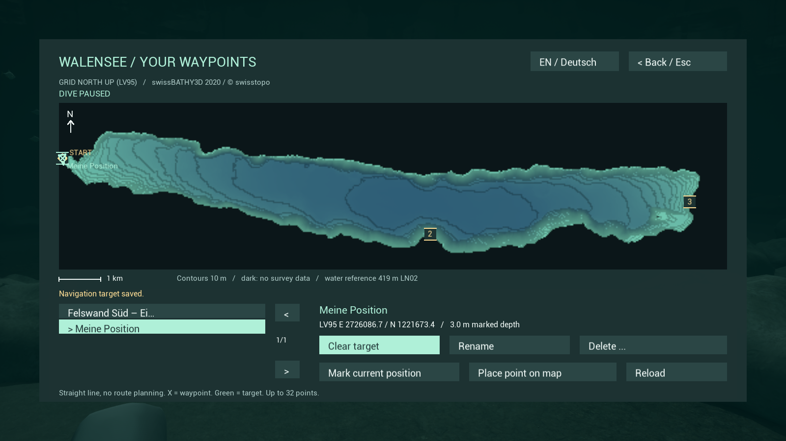
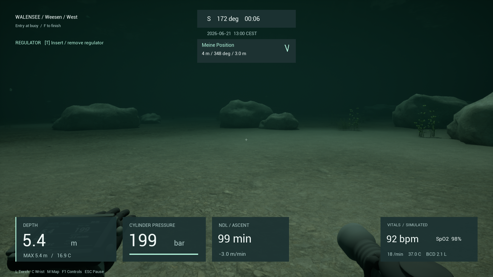

# Eigene Wegpunkte

NAV-006 ergänzt benannte, lokale Wegpunkte für den Walensee. Während eines Tauchgangs öffnet **V** die Bearbeitung und pausiert Simulation und Ton. Die Taste ist unter Steuerung frei belegbar. Wer bereits V anders belegt hat, behält diese Belegung; die neue Aktion bekommt durch den bestehenden Konflikttausch eine freie Belegung. Vor dem Tauchgang und im Pausenmenü führt **Einstieg → Wegpunkte** zur gleichen Ansicht.

**Eigene Position merken** übernimmt die aktuelle Spielerposition samt Tiefe unter dem mittleren Wasserspiegel. **Punkt auf Karte setzen** erwartet einen Klick auf vermessene Wasserfläche und verwendet deren Bodentiefe. Bereiche ohne Bathymetrie werden abgewiesen. Der Name darf 1–32 Zeichen enthalten; bis zu 32 Punkte sind möglich. Namen müssen innerhalb der Sammlung eindeutig sein, unabhängig von Groß-/Kleinschreibung. Kartenmarker und die seitenweise Liste wählen vorhandene Punkte aus. Umbenennen und Löschen stehen separat bereit; Löschen erfordert einen zweiten Bestätigungsklick.

**Als Ziel setzen** speichert genau ein aktives Ziel. Die Tiefenkarte zeigt dessen Namen, horizontale Entfernung, Gitterpeilung und gespeicherte Tiefe. Das Bildschirm-HUD ergänzt einen mit der Blickrichtung mitdrehenden Richtungspfeil. Das Ausblenden des HUD blendet auch diese Hilfe aus; auf der Karte bleibt das Ziel verfügbar. Der Handgelenkcomputer erhält in diesem Schritt keine zusätzliche Seite. Die Peilung ist eine Luftlinie, keine Prüfung auf Hindernisse oder erreichbare Tauchroute. Die Karte bleibt die vorhandene Übersicht über den gesamten See; für präzise lokale Punkte eignet sich die eigene Position.

Escape schließt zuerst einen Namensdialog beziehungsweise eine laufende Kartenplatzierung. Danach kehrt die Bearbeitung zum aufrufenden Menü zurück oder setzt einen direkt mit V pausierten Tauchgang fort. Die normale mit M geöffnete Tiefenkarte bleibt eine laufende Kartenansicht.

## Speicherung

Die versionierte UTF-8-Datei liegt unter `Saved/DiveWaypoints.json`. Sie enthält die Gebietskennung `walensee_lv95`, stabile GUIDs, Namen, LV95-Ost-/Nordkoordinaten in Metern, Tiefen, die Herkunft aus Kartenklick oder Spielerposition sowie die Ziel-GUID. Zentimeterkoordinaten des Unreal-Weltursprungs werden nicht als Speicherformat verwendet. Das Nachladen der Welt verändert diese Punkte daher nicht.

Die Datei wird auf Schema, Gebiet, Anzahl, Namen, doppelte IDs, endliche Koordinaten, Kartengrenzen, Tiefenbereich und vorhandene Zielreferenz geprüft. Eine unbekannte Version oder unlesbare Datei wird nicht überschrieben. Vor jedem Speichern wird der zuvor gelesene Inhalt mit der aktuellen Datei verglichen; erkannte externe Änderungen verlangen ein Neuladen. Eine temporäre Datei ersetzt erst nach erfolgreichem Schreiben den bisherigen Stand. Fehlgeschlagene Änderungen rollen den Speicherzustand zurück. Das ist ein lokaler Dateispeicher mit Konflikterkennung, keine Mehrbenutzerdatenbank.

Die Sammlung ist unabhängig von einzelnen Tauchkonfigurationsprofilen. Wegpunkte und aktive Zielwahl bleiben über neue Tauchgänge und Programmstarts erhalten. Sie sind benutzerdefinierte Markierungen, keine Behauptung geografisch bestätigter Sehenswürdigkeiten oder Entdeckungen. Der bestehende Prototyp speichert weiterhin pro lokalem Build-Verzeichnis; zwischen Paketordnern wird keine automatische Migration vorgenommen.

## Reproduktion

```powershell
./Tools/Build.ps1 -Target Editor -EditorSandbox
./Tools/Build.ps1 -Target Package -EditorSandbox -BuildSlot Waypoints -PackageDirectory Builds/WindowsWaypoints
./Tools/TestWaypoints.ps1 -PackageDirectory Builds/WindowsWaypoints
python Tools/ReportWaypoints.py artifacts/waypoints-validation-YYYYMMDD-HHMMSS --output artifacts/waypoints-report.json
```

Das Berichtswerkzeug benötigt Pillow. Native Unreal-Prüfungen sind unter `DiveSim.Waypoints` registriert. Sie prüfen unter anderem Koordinatenpräzision, Zielpersistenz, alle 32 Speicherplätze, ungültige Werte, beschädigte Dateien, Versionsgrenzen, erkannte Schreibkonflikte und die Übernahme älterer Tastenbelegungen.

Der Spieltest verwendet tatsächliche HUD-Hitboxen, simulierte gebundene Tasteneingaben und die Namensdialog-Callbacks. Seine 21 Schritte prüfen Planung, Platzierung, ungültige Namen, Umbenennen, Zielwahl, Pause, Löschbestätigung, Rückkehr zum Spiel und Neubelegung. Anschließend startet ein eigener Prozess, der die gespeicherte Sammlung und Zielwahl lädt. Alle Testdateien liegen getrennt von der Benutzersammlung. Ein zuerst gefundener Fehler mit identischen Kennungen für Kartenmarker und Listeneintrag ist korrigiert; die Auswertung weist diese Unreal-Hitboxwarnung ausdrücklich zurück.

Die Funktion ergänzt Navigation und Wiederfinden eigener Stellen. Das Entdeckungssystem, fachlich geprüfte Points of Interest, native macOS-Spielprüfung und die vollständige Anforderungsabnahme bleiben eigenständige offene Arbeit.

## Geprüfter Paketstand

Der abschließende Build liegt unter `Builds/WindowsWaypoints/divingsim.exe`. Die drei 21-stufigen Bedienläufe bestehen bei Weesen in 1600 × 900, Murg in 3840 × 2160 und Walenstadt in 1280 × 1024. Für jeden Ort besteht anschließend die Wiederherstellung in einem eigenen, neu gestarteten Prozess. Insgesamt wurden 30 frische Bilder mit korrekten Abmessungen ausgewertet. Die Berichte verknüpfen ausführbare Datei, gespeicherte Koordinaten, Logdateien und Bilder durch SHA-256: [WAYPOINT_RESULTS.json](WAYPOINT_RESULTS.json).

Vier zusätzliche Paketregressionen für Einstiegsauswahl, Steuerung, Uferablauf und normalen Tauchgang bestehen mit 23 weiteren Bildern. Alle 32 nativen Unreal-Tests, die deterministischen C++-Kernprüfungen und 21 Python-Tests bestehen. Der normale Programmstarter startet die erwartete Waypoints-Datei und beendet seinen eigenen Tauchtest mit Exitcode null. Quell-/Konfigurationsstand und Build-Sandbox stimmen vollständig überein. Der vorherige Caustics-Build einschließlich seiner Paketarchive sowie die bisherigen Wasser-/Bodenmaterialien und Shader sind nachweislich unverändert. Nachweise: [WAYPOINT_BUILD.json](WAYPOINT_BUILD.json), [WAYPOINT_LAUNCHER.json](WAYPOINT_LAUNCHER.json).

Für dieses UI-Inkrement wurde kein neuer Leistungs- oder zweistündiger Dauertest durchgeführt. Frühere Messungen sind keine aktuelle Hardwarefreigabe. Die native Spielprüfung erfolgte unter Windows; plattformübergreifende Kernprüfungen ersetzen weiterhin keinen macOS-Spieltest.

## Aufnahmen aus dem Windows-Paket

Unveränderte Spielaufnahmen aus dem abschließenden Paketlauf. Die Namen sind Beispiele aus dem Test, keine bestätigten Points of Interest. Die Kartenansicht zeigt die pausierte Bearbeitung; die zweite Aufnahme zeigt die Peilung im laufenden Tauchgang.




